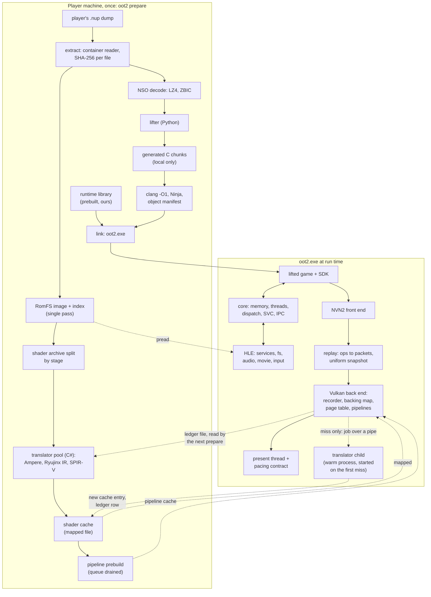
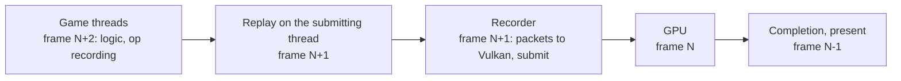

# oot2-native architecture

Status: revised 2026-11-09 (draft 8: draft 7, plus the maintainer's widened goal of 2026-11-09, the complete game running on his PC, recorded in section 1 and as milestones M6 to M11 in section 12, with his answers of the same day on who plays the route to the credits, the speed floor outside the Forest and the scene-entry seam; draft 7: draft 6, plus the maintainer's answers of the same day on the display (Q4): the refresh path, the game's output size, the window, the interpolation plan on this PC and what M1 to M4 read of the display, recorded in D22, D23, D26, D28, D29, M4, M5 and section 17; draft 6: draft 5, plus the maintainer's answers of the same day on the frame rate: the rate mode and its rates, the movie hold and the display queries, recorded in sections 1 and 12, D22, D29 and section 17; the earlier drafts recorded his answers to Q1 to Q8, the title movie path in M1, the pacing hold in the sync that `AcquireTexture` returns, the configuration and debug menu (D29) and what the runtime may read and write in the game's memory). This document proposes; the maintainer decides. Every architectural decision is a numbered proposal (D1, D2, ...) with the choice, the main alternative, the reason and the evidence. Spikes (S1 to S8) are short experiments that settle a decision before it is built on. Open questions are collected at the end (Q1 to Q21), each answerable in one line.

Evidence labels. **Measured**: taken on the reference PC (section 1). **Read**: read in another project's source or documentation, cited by project and path, or by URL and the date read. **Inference**: an interpretation, not a fact in a source. "The oracle" means oot-pc-recomp built from the maintainer's own dump and run on the reference PC. The reference projects, with URL, branch and the commit read, are listed in section 16; open pull requests are pinned there by head commit, because they can change.

## 1. Goals and constraints

**Target.** The Legend of Zelda: Ocarina of Time for Nintendo Switch 2 (update 1.1.1), recompiled statically into a native Windows x86-64 program with its own NVN2 renderer on Vulkan. Success: the complete game, from a new file to the end credits, runs on the reference PC with a console-faithful picture, its music, effects and movies (decided by the maintainer, 2026-11-09, M6 to M11). The first speed target stays 60 fps in Kokiri Forest, docked, 2560 by 1440 (M4), and M4's tier A checks then become the floor in every scene (M9). The first public release targets Windows and NVIDIA GPUs only (decided, Q3), so the mesh path may rely on a subgroup size of 32.

**Two operating tiers (decided, Q5).** Tier A, other applications closed: 60 fps, and optionally 120 fps on screen through frame interpolation (D28). Tier B, a browser and the maintainer's tools open: at least 30 fps, aiming for 40.

**Reference PC (Measured, 2026-11-05 to 2026-11-07).** Windows 10 (build 19045); Ryzen 5 5600X (6 cores, 12 threads); 16 GB RAM shared with other work; GeForce RTX 3060 Ti 8 GB, driver 617.14, Vulkan 1.4.351; a 1920 by 1080 monitor on HDMI 1.4 that offers 100, 74, 60, 59 and 50 Hz and no variable refresh (the driver reports it impossible on this link), so the PC has no display mode of 120 Hz or more.

**Memory on the reference PC (Measured).** Free RAM was 6,337 MB at the first oracle launch, about 7.8 GB at the second (the maintainer's other applications closed), and 5.1 GiB at idle with a browser and tools open. In the first launch the working set reached 6.6 GB in 21 s while free RAM fell from 6.3 GB to 0.5 GB. In the second it reached 7.3 GB with 0.4 GB free. In the third, which started with more free RAM, the working set levelled at 8.45 GB with 0.39 GB free after 30 s, Windows paged from then on, private commit reached 16.4 GB, and the world was still not reached after 11 minutes. In all three runs paging began or the guard stopped the run once free RAM was down to about 0.4 to 0.6 GB. The oracle's headline figure (10 GB reserved within 21 s, 13 GB before the world) is private commit, not RAM; what exhausted memory was the pages the game touched, imported pools and mirrors. Lazy commit alone therefore does not fit the game, so the budgets below count physical pages and are stated against available memory, not against a process ceiling. The RAM figures from the oracle's logs are in MB as the sampler printed them (probably MiB); the difference is under 5 percent and changes no conclusion.

| Device fact (vulkaninfo) | Consequence |
|---|---|
| Device-local heap 7.84 GiB, memory budget 7.09 GiB; ASTC no, BC yes | VRAM plan of 6.4 GiB (section 8); ASTC transcoded to BC (D19) |
| Mesh shader, pipeline libraries with fast linking, shader objects, pipeline binaries; extended dynamic state 3, vertex input dynamic state | D12, D16 |
| Buffer device address, host memory import (4 KiB alignment); sparse buffers (512 GiB works, device-local only) | raw addresses, pool backing (D14, D15) |
| 1,048,576 update-after-bind sampled images; sampler allocation count 4,000; 32 push descriptors | persistent bindless tables, samplers deduplicated (D10, D13) |
| Subgroup size fixed at 32; device fault and diagnostic checkpoints | D16; D17b |
| Cooperative matrix extension present, feature reported true | D20b |
| 64-bit integers in shaders; storage images read and written without a format; cube array images | what the translated modules declare (the capability check of the pipeline builder) |
| Memory allocation count limit 4,294,967,295 (the specification guarantees only 4,096) | D14: the count does not bind here, the other reasons do |

**Budgets (proposals).** The memory rows are stated against what the PC has available (D27).

| Resource | Target in the Forest route | Hard limit |
|---|---|---|
| Frame time, tier A | 16.67 ms; p99 at most 20 ms | no frame over 33.3 ms |
| Frame time, tier B | at most 33.3 ms (30 fps), aiming for 25 ms (40 fps, a Fixed 40 test mode and not the default, D22); p99 at most 40 ms | no frame over 100 ms |
| Process working set | at most 6.5 GiB | guard at 7.5 GiB |
| Available RAM on the PC, tier A | at least 1 GiB at every sample of the route | below 0.5 GiB the run is invalid |
| Paging, tier A | no pages written to the page file during the route | any sustained paging fails the gate |
| Paging, tier B | hard page faults of the process at most 100 per second averaged over 10 s, and no frame over 100 ms | see D27 |
| Process private commit | at most 8 GiB | abort at 9 GiB |
| VRAM | 6.4 GiB planned | 7.09 GiB measured budget |
| First-time preparation | about 90 minutes, no silent step over 1 minute; the shader and pipeline step is unmeasured (S1, S3, S6) | none |

**Legal model (decided).** The repository ships tools and a runtime only. Each player extracts, lifts and compiles from their own dump, checked by SHA-256. No game code, generated C, shaders, assets, keys, firmware or captures enter the repository or its releases. Licence GPL-3.0-or-later: GPL and MIT fragments may be reused with their notices.

## 2. Module map

The translator is one executable used in two places: as a pool of children during prepare, and as one warm child of `oot2.exe` that exists only to serve a miss (D20, D21). The boundary between the runtime and the translator is therefore a run-time process boundary, not only a build-time one.

| Module | Language | What crosses the boundary |
|---|---|---|
| `tools/` extract, nso, lift, gen, build driver, installer steps, content guard | Python 3.12+, numpy | files only |
| `runtime/core` memory, loader, threads, dispatch, SVC, IPC | C11 | `Cpu*`, `rt_dispatch`, `rt_svc`, host-function table, layout header |
| `runtime/hos` services, filesystem, audio, movie, input | C11 | `nn::` override table; IPC for service lookup and the four audio services |
| `runtime/nvn` NVN2 front end | C11 | `GfxBackend` operations (a null back end allows CPU-side tests) |
| `runtime/gpu` Vulkan back end | C11 | SPIR-V plus a resource description per program |
| `runtime/platform` window, input, audio device | C11 over SDL3 (D24) | platform header |
| `runtime/ui` configuration and debug menu (D29) | C++17 without exceptions or run-time type information, behind a C header | the C header |
| `xlate/` shader translator | C# (.NET 10, NativeAOT) | stdin/stdout line protocol; also launched by the runtime on a miss |

The runtime is C11 except `runtime/ui`, the one C++ directory, which stays behind a C header (D29; Read: oot2-native runtime/include/oot2/ui.h).

## 3. Player-side build pipeline

Oracle timings on the reference PC (Measured): extraction 2,751 s (372,587 files; a first attempt stopped on a transient permission error and was resumed), RomFS pack 1,520 s (24.49 GiB), lift 260 s on 3 workers (297,414 functions, 0 unsupported instructions, 1.2 GB of C), compile 1,299 s on 6 jobs (2.65 GiB peak, 314.5 MiB program).

**D1. Language split.** Choice: Python tools and lifter, C11 runtime (generated code is C and calls it directly), C# translator (Ryujinx IR and nxnative's decoder are C#). Alternative: one native language, rewriting the lifter. Reason: lifting takes 260 s against a 22 minute compile. Evidence: oracle timings; Read: DKB Recomp recomp/gen.py, recomp/lifter.py. Revisit above 10 minutes.

**D2. Single-pass extraction, RomFS served in place (decided).** Choice: read the container's table of contents, take the newest update's tree, write the ExeFS files loose (each checked against its SHA-256 and size), and serve the RomFS from the player's own `.nup` through an index of container offsets when every file of the tree is stored raw; when any file is zstd-compressed, stream each RomFS file once into a packed image instead, verifying each file's SHA-256 and size (the fallback). Names that leave the output folder are refused in both forms. Alternative A: always copy the image (the extract and decode step as first built): 23.47 GiB and 791 s on the player's dump. Alternative B: oot-pc-recomp's two passes (loose tree, then pack): 4,271 s (Measured) and about 55 GB of disk (a planning estimate, not a measurement). Reason: every record of the player's dump is raw, so the container already holds each file contiguous and unmodified; an index into it costs seconds and no copy. The price is that the program reads a file the player owns: its path is recorded at prepare, and oot2.exe checks it at every start by size and by the SHA-256 of 16 fixed 64 KiB ranges (the first holds the superblock, whose table-of-contents hash names every file's size and SHA-256), so a dump moved, replaced or changed stops the start with a named error that asks for prepare again, never a read of the wrong bytes. The files themselves are hashed only by `oot2 prepare --verify`, which reads the whole dump. Evidence: Read: oot-pc-recomp tools/extract_nup.py:85, 182-186, 271-274, 351; the container holds each file raw or zstd-compressed (tools/extract_nup.py:3-4). Built (the extract and decode step, `tools/prepare/nup.py`, `extract.py`, step `extract`): the tree is the newest update's whole tree, not a per-path overlay, because an update package lists every file of the patched tree, its unchanged files pointing at the base's extents; the 225 files only the base lists in the player's dump are versions the update replaced (the four `.Product.100` shader archives among them) or files it removed. An extent that several paths name is stored once (186,583 paths, 159,532 stored). Built (the RomFS in-place serving, `extract.py`, `program.py`, `build_game.py` `sample_ranges`, `runtime/program/main.c`): the index layout is the same in both forms, its image being `romfs.bin` or the `.nup` (offsets and image size are those of that file); the step's record says which form it wrote and, in place, the `.nup`'s path, size and SHA-256; a copy an earlier run wrote is deleted; the program's glue names the `.nup` as the "RomFS image", with the sampled SHA-256 that `RtGameFile.sample_sha256` carries. Measured on the player's dump for the copy (laptop hard disk, shared with another job): 791 s for the single pass, 23.47 GiB of image; for the in-place index in the extract and decode step's spike: 6.5 s to write, 20.4 MiB.

**D2a. The ZBIC decoder is fetched, not shipped (decided, Q2).** Choice: the prepare step downloads the third-party zstd fork that decodes ZBIC-compressed modules at a pinned commit, checks the archive against a SHA-256 baked into the tools, builds it locally with the bundled toolchain, and uses it only to turn the player's own modules into plain ones; a player who already has plain modules can supply them instead and the step is skipped. Alternative A: vendor the fork's source in the repository (BSD-3-Clause allows it). Alternative B: require plain modules from every player. Reason: the repository then contains no decoding code for a console-specific container format, which keeps the public switch simple to assess, while players keep a one-step path from their own dump; the pin and the hash make the fetch reproducible, and B would push every player toward third-party dumping tools. The fetch adds one network dependency to prepare, and a fork that disappears breaks it, so the notices name the source and the prepare step reports the failure plainly. Evidence: Read: oot-pc-recomp tools/zbic/zbic_dec.c:3 and tools/zbic/README.md. Built (the extract and decode step, `tools/prepare/zbic.py`, `modules.py`, step `modules`): the pin is a SHA-256 of the archive's contents (each file's path, size and hash), because GitHub builds source archives on request and their bytes can change while the files do not; the decompression sources are built with the player's C compiler as a shared library and called through ctypes; `--plain-modules` and `--zbic-archive` are the offline paths. Measured: download, check and build 26 s on the laptop; the player's `main` decodes byte for byte to the oracle's plain module.

**D3. Lifter conventions.** Choice: DKB Recomp's design (hot registers and flags as C locals, one C function per guest function) with three changes. Callee-saved trust stays on except in functions that call setjmp or longjmp or contain a landing pad; those keep every register in the `Cpu`, and setjmp call sites are recognised by the lifter and compiled to host-level setjmp. C++ exceptions are not unwound: the throw entry points are a named fatal that prints the type and a guest backtrace, with a run-time log of throws, catches and long jumps. Alternative: table-driven landing pads now. Reason: the game module has 6 throw helpers and the SDK 18; of 2,196 catch pads 2,187 only terminate; attributable engine code has no landing pad (Inference: throws are error paths; the log decides). DKB Recomp's trust premise (no longjmp or unwinder imports) is false here: 3 setjmp and 4 longjmp callers. Evidence: Read: DKB recomp/regs.py:10-14; LASRecomp runtime/hle/warp.c:838-851.

**D4. Build and link.** Choice: clang `-O1 -march=x86-64-v3` for generated code, Ninja, a SHA-256 manifest of every object checked before link, and the runtime prebuilt as a static library. Alternative: one monolithic build. At each start the loader re-hashes the plain ExeFS files against values baked at build time and checks the RomFS index hash and image size, and for a RomFS read in place the dump's path and sampled SHA-256 (D2). Reason: a runtime edit costs a relink, not 22 minutes of compiling. Evidence: Read: DKB tools/build_game.py:3-52, 94-97, 156-160; oot-pc-recomp runtime/loader.c:77-92, romfs.c:5-9; TotK docs/installer.md step 5.

**D5. Resumable steps.** Choice: TotK Recomp's step-key rule (each step stores a fingerprint of its inputs and upstream keys; install, resume and update are one rule). Alternative: a linear script. Reason: a long run will be interrupted. Evidence: Read: TotK installer/runner.py:1-15.

First-time preparation, estimated (Inference): extract and pack 25 to 45 minutes, lift 5, compile 22, which is about 52 to 72 minutes before shaders. The shader and pipeline step is unmeasured and has no estimate until S1 (translation), S3 (library builds) and S6 (compute builds) report; the method is the sum over programs of the measured p50 build time divided by the worker count, using the program counts of section 7. About 31 GiB of outputs beside the player's 25.6 GB dump with the RomFS copied, 23.5 GiB less when it is read in place (D2), before the translate step; that step keeps about 6 GiB (its pack and split) and holds about 5.5 GiB more while it runs, so the check step asks for 38 GiB (Inference, from S1's modules; the translate step records the measured sizes).

## 4. Runtime

Built (D6): Windows watched reservations are split into 64 MiB pieces; first-touch handling commits 64 KiB chunks only in declared guest ranges, and host I/O commits its destination explicitly.

**D6. Address space with commit on first touch.** Choice: identity-map guest to host addresses (loads and stores are raw pointer accesses), reserve heap, alias and stack windows with `MEM_RESERVE | MEM_WRITE_WATCH`, sized from the program's declared sizes, and commit 64 KiB chunks from a vectored exception handler only inside ranges the guest's SVCs declared mapped. A touch elsewhere is a named fatal; host I/O into guest memory commits its target explicitly (a file read into uncommitted memory does not fault); unmapping decommits. Alternative: commit at SetHeapSize and MapPhysicalMemory, as the oracle does. Reason: private commit then tracks the pages touched. This does not by itself reduce RAM, as the oracle's 6.6 GB working set in 21 s showed; D14, D19 (lever L1) and D27 do. The game requests a heap of about 6.2 GiB (Read: nxnative issue 1361 log, 2026-11-05) and nxnative's OoT profile reserves 12 GiB with a 2.4 GiB alias region (Read: nxnative pull 1299, 2026-11-05); the game's virtual address memory is declared at about 2.7 GiB (Inference, rounded, from the game's declared pool sizes; nxnative issue 1326 shows 2.00 GB mapped near its failure). Report console-faithful memory values; the oracle raised TotK's. Evidence: Read: oot-pc-recomp runtime/memory.c:34-36, 282-290; LASRecomp runtime/platform/windows.c:14-45.

**D7. Threads and kernel model.** Choice: one host thread per guest thread (256 MiB reserved stack); virtual cores, with the count taken from the program's metadata; a thread runs guest code only while holding a core; priority preemption at SVCs and indirect dispatch; asynchronous preemption by suspending a thread after a quantum; host blocking calls release the core; spin loops are gated. Alternative: free-running host threads. Reason: the guest's priority and core-mask assumptions and its futex traffic need an ordering the host scheduler does not give. Lichii's notes record about 1,400 SVCs per frame from a job system's wait and signal pairs (Read: Lichii NX2_NOTES.md, row 109), but they do not name OoT and the rows around it concern another Switch 2 title, so OoT's rate is unmeasured. Evidence: Read: DKB runtime/kernel.c:7, 31-32; docs/architecture.md:62-77. OoT's spin loops must be found by scanning (857 is TotK's count).

**D8. Indirect calls.** Choice: DKB Recomp's flat table, one 32-bit slot per guest instruction word, sealed read-only, plus a small hash for host functions. Alternative: binary search with a per-thread cache (LASRecomp). Reason: O(1) and lock-free for about 0.1 GiB. Evidence: Read: DKB runtime/dispatch.c:1-24.

**D9. SDK boundary and services.** Choice: lift the SDK module and run it; replace public `nn::` entry points that reach a service with host functions bound by symbol at load; real IPC only for service lookup and the four audio services (`aud:u`, `audren:u`, `auddmg:u` and `audsmx:u`, with CMIF domains served for a client that converts a session); every unimplemented SVC, command or import is a named fatal (a first boot is then a free census). Alternative: full IPC emulation (LASRecomp), or zero on unknown calls. Reason: the host-function level is smaller, has booted a Switch 2 title, and zeros hide faults. Evidence: Read: DKB runtime/ipc.c:1-29, svc.c:42-48, hostfn.c:89-110. The game declares 46 services and about 48 SVCs plus one Switch 2 only SVC, and imports 846 `nn::`, `nv::` and `movie::` symbols; DKB Recomp hooks 124, nxnative 218, and at least one of four projects hooks 226 (Measured by exact symbol match). Gaps, in blocking order: the AV1 movie decoder; offline answers for socket and network calls made at boot (Read: nxnative docs/reference/services.md); seven SVCs DKB Recomp lacks; SDK 22 name drift in a few startup calls.

## 5. NVN2 front end

**D10. Object model and tables.** Choice: nxnative's model: NVN objects stay in game memory with host records packed under the SDK's size, a serial on textures and programs so copies by value stay distinguishable, and persistent bindless tables: one image array and one sampler array in Vulkan, indexed by the game's pool IDs, updated incrementally on registration, samplers deduplicated by state. A pool that has guest memory needs no GPU address allocator (its GPU address equals its guest address, valid because guest pointers are real host pointers); a pool without guest memory gets its address from the allocator of D14. The entry-point table is generated from the public name list; the roughly 286 names the game references get bodies, the rest stop with their name. Alternative: rebuild a handle table on every registration. Reason: nxnative measured 94,000 whole-table builds in 90 s on OoT; fixing it cut submit time from 45 ms to 5 to 8 ms (Read: https://github.com/seedds/nxnative/pull/1299, 2026-11-06). Evidence: Read: nxnative dm/gfx/nvn/nvn_obj.h:12, 41-44; DKB runtime/nvn_procs.c:1-32.

**D11. Command buffers.** Choice: ops go to a growable host buffer per command buffer and replay at queue submit, never into the game's command memory. Alternative: nxnative's records in game command memory. Reason: simpler and proven in DKB Recomp; the risk is a game that patches recorded words in place (nxnative documents one), which the first census checks. Decision A (2026-11-07): oot2 never sets the NVN driver's nvnPrivate0, so the game's inline command paths never run and the front end records every command from its entry points; option B (setting the flag) returns as its own piece of work only if the per-frame call cost measured at the title and later in the first field scene breaks the 5 ms row. Evidence: Read: DKB runtime/nvn_api_cmd.c:7-14; nxnative docs/reference/nvn-objects.md:244-250.

**Semantics that must survive** (Read: nxnative docs/reference/rendering.md, frame-rate.md; DKB runtime/vk_exec_xfer.c:15-29, 305-335): fences complete in submission order and write their words after GPU completion; report counters carry honest timestamps in the console's tick (31.25 MHz on Switch 2); conditional rendering is decided at replay from earlier reports (an incomplete timestamp counts as zero, an incomplete occlusion result as visible); compute overlap modes act as full barriers. `WaitEvent` (37 static sites) is a no-op in all three reference projects, harmless only while one queue runs in submission order (Inference), so it is on the census list; here a wait that the replay so far does not satisfy holds its queue (and the queue's later submissions) until a signal of another queue or the CPU's releases it, and the null back end orders the queues' records that way (the Vulkan back end still replays in submission order and only checks the wait at completion, `runtime/gpu/vk_submit.c`) while fence values still come out of submit in one numbering and a value is done when its own queue's work up to it is, whatever another queue is held at, so a thread that waits on one queue is never held by a wait on another (`runtime/nvn/nvn_order.c`, `gfx.h`). A `SyncWait` retry loop with a timeout on a queue held at a wait nothing releases never reaches a stop: the stop is for a wait with no timeout (`gfx.h`, rule 5).

## 6. Vulkan back end

### 6.1 Threads, pipelines, descriptors

| Thread | Work | Runnable at once in play |
|---|---|---|
| Guest threads (virtual cores) | game logic, job system, physics, NVN2 op recording (D7) | up to the core count in the program's metadata (3 to 6 are assumed; the real count is read at load) |
| Submitting guest thread | replay: ops to packets, descriptors, uniform snapshot (D12); it is one of the guest threads, so its replay time adds to the game's own render work | counted above |
| Recorder | packets to Vulkan commands, queue submit (Read: DKB vk_rec.c:1-22) | 1 |
| Completion | one timeline semaphore; CPU-visible effects in order (Read: DKB vk_sync.c:1-9) | 1, mostly blocked |
| Present | game swapchain image to the window, pacing contract (D22) | 1, mostly blocked |
| Audio renderer | the frame clock's grid: mixing for the SDK's audio renderer, the frame event, the sink write (D24a); it holds no virtual core and never waits for the sink | 1 |
| Audio stall watchdog | polls every 50 ms on its own clock for a guest thread waiting on the renderer's event, a wave buffer not released, or a missing update, and names it (D24a) | 1, mostly asleep |
| Movie decode | AV1 decode (D24b) | 0 in play, 1 in movies |
| Workers (2 to 4) | staging and texture upload preparation; library builds and translation on a miss (policy below) | 0 to 2 |

Core allocation (proposal). The reference PC has 6 cores and 12 hardware threads. In play up to 6 virtual cores, the recorder, the audio thread and the present thread can be runnable, which is 8 to 9 threads on 6 physical cores, leaving 3 hardware threads for the completion thread, workers, Windows and whatever else the maintainer has open. There is no hard affinity at first. Virtual cores run at normal priority (the guest's priorities order them among themselves, D7), the recorder and present threads above normal, workers below normal. M1 adds per-thread CPU time per frame to the capture so that this table can be corrected with data.

How frames overlap. In steady state the stages work on different frames:

At most 2 frames are in flight between the start of a replay and GPU completion; the 16 MiB recorder ring and the timeline semaphore enforce this, and the pacing contract (D22) keeps the guest from running further ahead. The requirement is on throughput, not on the sum: each stage, and each guest thread, must finish its share of a frame in at most 16.7 ms, while latency from submit to display grows by about two frames (Inference). The stage budgets in section 6.2 therefore need not add up to 16.7 ms, but the render thread, which carries the game's own render work plus the replay, has to fit in 16.7 ms by itself.

**D12. Replay on the submitting thread; pipelines from libraries with dynamic state.** Choice: replay on the thread that submits, feeding the recorder through a 16 MiB ring. Pipelines are graphics pipeline libraries (vertex input, pre-rasterization including task and mesh, fragment, output) with vertex input, viewport, culling, depth, stencil, blend, logic op and topology dynamic wherever the device allows, so a pipeline is a function of shader stages and attachment formats and the pipeline count follows the shaders the translator enumerates, not the state combinations the game reveals during play. Alternative A: shader objects (supported here, less field use). Alternative B: full-state pipeline keys as nxnative does (nvn/nvn_pso_skey.h:7-17). Reason: DKB Recomp and TotK Recomp record that the replay takes 17 percent less time on the submitting thread when a separate recorder thread makes the Vulkan calls (measured on a Radeon RX 9070, an AMD card), which is why section 6.1 has a recorder; their asynchronous replay thread showed no gain in DKB's timings and is off by default in both, so replay stays on the submitting thread. Neither result was measured on NVIDIA, and TotK Recomp turns the recorder off by default on AMD cards where it loses the device, so S3 includes a replay benchmark on the reference PC with the recorder on and off. S3 also measures fast-link cost against shader objects and may overturn the choice. Evidence: Read: DKB docs/architecture.md:84-92 and TotK docs/architecture.md:87-88; DKB runtime/vk_pipeline.c:1-30, 2960-2964; oot-pc-recomp runtime/vk_backend.c:15-20. Built (the pipeline builder, `runtime/gpu/vk_pipeline.c`, `oot2/vk_pipeline.h`): the builder reads modules and descriptions by stage key from the shader cache pack and makes a pre-rasterization library per vertex module, a fragment library per pixel module (its depth and stencil formats undefined, so it links with an output library of any formats), one output library per attachment formats, one shared vertex input library and, from the four, a fast link per (pair, formats); a vertex module is padded with the outputs its pixel module reads and it does not write (`spv_add_outputs`, initialised to (0, 0, 0, 1), the padded library keyed by module and pad set), and a compute pipeline is made per module, from the module with its workgroup memory given the null value of its type (`spv_zero_workgroup`, with the Vulkan 1.3 feature `shaderZeroInitializeWorkgroupMemory`, enabled where the GPU reports it): the title movie's last pass, an upscaler network, reads workgroup words it never writes (Measured: with those words filled with zeros the picture is right, with NaN bits every tile comes out black, and left as the dispatch before left them the workgroups of the first waves, which find another program's data there, came out as a band of flat tiles across the top of the picture, 14 tile rows high), and the console's program is right only when they are finite (Inference). Everything is made through one per-player `VkPipelineCache` whose header must name this device's vendor, device and pipelineCacheUUID, or it is dropped and rebuilt; no pipeline is created while a submission is in flight (a named fatal; what already exists is returned), any number of threads may ask at once, and objects are referenced by stage key so that `vkp_release` can let a program's go. Measured (desktop RTX 3060 Ti, 120 pairs by the pipeline cost study's selection and 208 compute programs): cold, a pair p50 212 ms and p99 1.09 s on 4 threads; warm in a second process, the driver served all 240 shader libraries and all 208 compute pipelines from the cache, a pair at p50 1.0 ms and p99 9.0 ms, a compute pipeline at p50 0.31 ms and p99 9.7 ms; the driver reports a fast link and a library without a shader as no cache hit, since neither is compiled.

Built (the recorder in `runtime/gpu/vk_rec.c` and submission path in `runtime/gpu/vk_submit.c`): the recorder consumes the packet ring and submits each frame's main command buffer. The submitting thread holds the submission gate from replay start until that frame is submitted, and the submission includes a separate epilogue command buffer after the main commands.

**Pipeline build policy (one policy for D12, D17b, D21 and the milestones).** Proposal:

1. Before the first frame, everything that can be enumerated is built: in the prepare step, and again from the cache at each launch. That is every compute, task and mesh pipeline, the vertex and fragment libraries, and a linked pipeline for each (program, attachment formats) pair the ledger holds. The queue is drained while this runs. Built (the pipeline step, `tools/prepare/pipelines.py`, `pipesched.py` and `tools/pipebuild/pipebuild.c`): prepare's pipelines step builds every compute pipeline and every vertex and fragment library of the shader cache with the GPU the runtime would open, on worker processes sized from the free memory (the largest builds alone, compute held to six at a time), into one application pipeline cache, `pipelines/pipeline.cache`; a stopped run keeps what it saved, and a driver update builds again (the device's pipeline cache UUID is in the step's key). When the key changes the previous cache is checked (header, size, runtime, device and driver) and kept as the seed of the new build, so the programs whose module did not change are served warm and only the changed ones build cold; a cache that fails a check is dropped by name (`tools/prepare/pipeseed.py`). Vertex libraries are built as translated, without padding: the padded ones are known only from play and come from the ledger. Task and mesh pipelines are counted as not built until the mesh draws ticket, so every total is a lower bound.
2. During play no pipeline is created, linked or optimized on any thread while game GPU work is in flight. There is no background optimizer: prepared pipelines are already complete, so there is nothing to swap in. The drained-queue rule therefore applies to the prepare phase and to the miss path, and nowhere else.
3. A miss (a pipeline nothing enumerated) is the exception path, a defect, and a gate failure for M3 and M4. Its cost is defined: the replay thread stops, the queue drains, the missing libraries are built in parallel on workers and linked, and the draw is replayed; the program identity and the stall are logged and counted. For graphics a wait beyond a bound (proposed 2 s; S3 and S6 set the real value) skips the draw with a named log line; compute and mesh misses wait without a bound, because a skipped dispatch changes what the game computes.
4. A fast link on the draw path (DKB Recomp links on the draw's own thread: 0.12 ms for a warm library, 5 to 180 ms when the library is built cold, Read: runtime/vk_pipeline.c:2960-2964) counts as a build on the frame path until S3 has measured it on the reference PC. S3's p99 link time is reported in the M3 exit, and ledger pipelines are prebuilt complete so that steady play links nothing.

Built (the miss path, `runtime/gpu/vk_miss.c`, `oot2/vk_miss.h`): a draw or dispatch whose pipeline does not exist asks the miss path, not the builder. The replay thread, which holds the submission gate, drains the recorder's ring (every packet of the frame so far has made its call) and then the timeline (every submission handed to the queue is done); the queue counts as idle while the only submission not done is the one being replayed, which has put nothing on it. A graphics build then runs in a job thread that builds the vertex and the fragment library side by side and links; the replay waits for it for at most the bound (2 s; `OOT2_VK_MISS_BOUND=<ms>` sets another and `unbounded` is the development override that waits and still counts the waits past the bound as `would_skip`). Past the bound the draw is skipped with a named line and counted (the capture's skipped-draw and pipeline-miss counters), the draws after it that name the same pipeline are skipped at once, and the job goes on: that is the one place a pipeline is created with work in flight, told to the builder by a flag and counted as a late build. A draw is skipped only where its colour and depth targets hold an earlier frame's picture (a target this frame already wrote, or one never drawn, makes it wait), and a dispatch is never skipped. `program_release` counts stage keys held by live programs; a key nothing holds is given the newest value handed out and its pipelines are destroyed once the timeline has published that value. The replay also counts the draw and dispatch records it received against those it replayed, skipped or found rendering off (`lost`, 0 by contract).

Built (the GPU timing, `runtime/gpu/vk_gpu_time.c`, `oot2/vk_gpu_time.h`): a measuring tool, off by default, for the frame the GPU cannot finish in time, which the replay's own counters show only as a wait for the frame two before. With `OOT2_VK_GPU_TIMING=<file>` every replayed frame gets a timestamp query pool, a timestamp at the end of all commands before it after each dispatch, render pass, transfer and explicit barrier (`OOT2_VK_GPU_TIMING_MARKS=off` keeps only the ends of the prologue, the main command buffer and the epilogue, which leave the GPU's overlap as it is), and the completion thread writes one row per frame and per mark once the device reached it: the time, the stage key, the group counts and, for each buffer a dispatch binds, the backing it resolved to (VRAM extent, host import, mirror), its size and guest address; every sixtieth frame one more row carries the backing map's and the raw path's counters. The recorder carries the timestamps as one more packet (`WriteTimestamp2`).

Reason and evidence. A pipeline built or linked on the frame path is a stall by construction, and the numbers above show it is not a small one when a library is cold. Separately, a confirmed NVIDIA driver bug of the same era shows that creating a second compute pipeline that is never bound can make an earlier, unrelated dispatch fail with device loss on RTX 4090 and 4070 SUPER cards (driver 616.56 and 616.92; NVIDIA filed an internal bug on 2026-09-22 and reported a fix submitted on 2026-09-28; Read: NVIDIA developer forums, https://forums.developer.nvidia.com/t/windows-vulkan-unused-compute-pipeline-causes-device-loss-on-rtx-4090-4070-super/383848, read 2026-11-06). Nothing ties it to DKB Recomp's fault, and it does not name the reference GPU, but it is the reason to keep pipeline creation away from work in flight (Inference). The drained-queue rule costs nothing at load time.

Alternative to the policy: DKB Recomp's, which fast-links on first use and swaps in an optimized pipeline from a background thread while the game runs. It trades a hitch per new pipeline for an earlier start, and it builds with work in flight, which is the hazard D17b records. If prepared pipelines turn out too slow to load at launch, an undrained optimizer returns as a new proposal with that hazard accepted knowingly.

**D13. Descriptors.** Choice (layout `uni`, measured by S3 and numbered by the stage bindings work): one pipeline layout for every graphics pipeline, so that a vertex or pixel module is translated and built once whatever it is paired with. Set 0 is global and update-after-bind (D10), bound once per command buffer: binding 0 the game's texture pool of 33,025 sampled images, every image type a view of the one binding, binding 1 its 4,096 samplers. Set 1 is one push-descriptor set of at most 32 descriptors: binding 0 the support buffer, shared by every stage, then fixed slots per stage and kind, a module's n-th constant bank in its stage's n-th uniform slot and likewise for storage buffers and storage images (vertex or mesh: uniform 1 to 8, storage 9 to 13; pixel: uniform 14 to 24, storage 25 to 29, storage images 30 and 31). Push constants, 128 bytes for every stage: 16 for the page-table address and span (D15), then 28 texture slots of 4 bytes (vertex 0 to 4, mesh 0 and 1, pixel 5 to 27), each holding the NVN handle of a bound texture (texture ID in bits 0 to 19 indexing binding 0, sampler ID in bits 20 to 31 indexing binding 1); a texture array takes one slot, its element i at both IDs plus i, so the host lays an array out in consecutive entries. Pool textures index the same arrays by the handle the program read and take no slot. A compute pipeline has a layout of its own with the same sets (uniform 1 to 8, storage 9 to 24, storage images 25 to 31, texture slots 0 to 27): its programs need up to 14 storage buffers, more than the 10 storage slots the vertex and pixel ranges hold together, and at most 20 descriptors at set 1 (the compute, task and mesh layout). A mesh module takes the vertex stage's buffer slots (uniform 1 to 8, storage 9 to 13) and texture slots 0 and 1. A task program's buffers are in a set 2 the host writes per draw (uniform 0 to 7, storage 8 to 15; at most 7 used), because a mesh pipeline's three stages do not fit 32 push descriptors (support buffer 1, mesh 13, pixel 18, task 8). Push constant bytes 24 to 35, the vertex stage's slots 2 to 4, which no stage of a mesh pipeline uses, are kept for the draw's first task (D16); words 6 and 7 hold the device address of one 32-bit word that holds the first task, and word 8 is kept and written as 0; the task stage reads that word, or the mesh stage when there is no task stage, and adds it to its workgroup number (the mesh bindings work). The slot counts are the corpus maxima: every one of the 56,381 modules fits (the stage bindings work), and the 360 task and mesh programs only the base game's archives hold (6 task, 354 mesh) need no more than the update's (the compute, task and mesh layout); a module that would not still translates, with its excess numbered past the layout and named in its description. The translator writes this numbering and describes each module (schema 2): its slots, the vertex inputs and outputs by location, which support buffer fields it reads, the storage buffer contract and a frag-coord flag that counts FragCoord.w. Alternative A: DKB Recomp's layout, one set per pipeline and no push constants, with handle-indexed textures resolved by the host at replay. Alternative B: D13 as first written, set 0 per draw by push descriptors and set 1 global. Alternative C: descriptor buffers (present, less used). Reason: S3 measured `uni` as the cheapest layout on the CPU (10 to 27 percent under the other two per draw when every draw changes pair, 30 to 45 percent when runs of eight share one), clean under validation, at about 0.13 microseconds more GPU time a draw for its indexed textures; D13 as first written and DKB's layout fall back to an allocated set for the 13 percent of pairs over 32 descriptors, and their per-pair set layouts tie a library to its partner (S3, finding F7). The global set comes first because pipeline layout compatibility runs from set 0 upward (S3, finding F6). Evidence: Measured: S3 (the pipeline cost study), the stage bindings work (the stage bindings study), the compute, task and mesh layout; Read: DKB runtime/vk_exec_draw.c:142-150, nxnative pull 1299 documentation patch (the 33,025-entry pool), nxnative dm/gfx/nvn/dmsh_abi.h. Built (the pipeline builder, `runtime/gpu/vk_layout.c`, tested against `xlate/host/UniLayout.cs`): two pipeline layouts, one for every graphics pipeline and one for compute, sharing one set 0; the graphics layout also carries set 2 (the task stage's buffers) and its push constants reach the vertex, fragment, task and mesh stages, so that a fragment library links with a vertex or a mesh library alike. The capability check over every module of the pack (42,847 modules of the updated game's set, and 56,381 with the base-only jobs) found five capabilities that no required item enabled; the list of `oot2/vk_required.h` gained `shader_int64` (2,247 modules, the raw-access helper), `storage_image_formats` (313 write, 56 read) and `cube_array_images` (69), and with them the check passes over both sets once the fifth is gone: StorageImageArrayNonUniformIndexing (4,828 modules) was declared by the translator next to the sampled image one although no module indexes a storage image array, so the translator now declares it only where one is indexed non-uniformly (the post-pass of `xlate/host/SpirvFixup.cs`), and no required item asks for it. The device still enables the feature whenever the GPU reports it (the optional list of `oot2/vk_required.h`, which is not part of the required list: a device without it is still chosen), because shader packs prepared before that change declare the capability in about 9,500 modules, and the pipeline builder allows a capability exactly when its feature is enabled; a device without the feature refuses such a module by name.

### 6.2 Frame and per-draw budget (targets)

| Stage | Throughput requirement | Target | Basis |
|---|---|---|---|
| Game render thread: guest render work plus replay | at most 16.7 ms per frame | p99 at most 12 ms (M4 gate) | unmeasured; the oracle held 60 fps at the title with the render thread never blocked and CPU as the bounding side (Measured) |
| of which replay | inside the row above | at most 5 ms | Read: DKB replay averaged 5.6 ms a frame in one scripted run of another game, draw count not stated (docs/devlog.md:150-152); nxnative submit 5 to 8 ms on OoT, Apple M5 (pull 1299 README) |
| Other guest threads (job system, physics, audio mixing) | each at most 16.7 ms; they share 12 hardware threads with everything else | unmeasured | measure from M1 (per-thread CPU time per frame); the oracle at the title is a floor, not a forecast for the Forest |
| Recorder | at most 16.7 ms | 4 ms | Inference |
| GPU | at most 16.7 ms | 14 ms, unmeasured | context, not basis: nxnative reports 14 to 21 ms on an Apple M5, the bottom of a range on different hardware (pull 1299 README); nobody has measured OoT on NVIDIA |
| of which the game's neural upscaler | inside the row above | 3 ms proposed; measured p99 2.5 ms at the full-scale input, 1.8 to 1.9 ms at the dynamic-resolution sizes (replay, GPU alone) | D20b, S8, the upscaler cost study |
| Completion, present | at most 16.7 ms | 1 ms each | Inference |

No OoT draw count is published or measured. The per-draw budget is therefore the replay target divided by the draw count of the first census, not a number fixed in advance. If the census puts replay over budget, the levers are cached descriptor sets, secondary command buffers per pass, and fewer per-draw checks (nxnative runs about 25; Read: nvn_mtl.m:10888).

### 6.3 Pools, raw addresses, mesh

Built (the backing map in `runtime/gpu/backing.c` and Vulkan memory path in `runtime/gpu/vk_backing.c`): the map uses 64 MiB import cells for committed host ranges and VRAM mirrors for hot CPU-visible ranges. Mirror admission uses current device-local heap usage and `VK_EXT_memory_budget`, including the one-eighth headroom rule; imports remain bounded to aligned 64 MiB windows.

**D14. A backing map, not a pool-to-allocation mapping.** The game creates 4,097 to 4,660 pools in the Forest (Read: nxnative issue 1326 and pull 1360 comments). Choice: no Vulkan allocation per pool. Pools are guest ranges in a sorted index. One runtime table decides per 64 KiB page what the GPU sees: nothing; a VRAM extent (render targets and GPU-only data, created lazily); a VRAM mirror (buffer-bound ranges, admitted by DKB's rule: used plus size plus an eighth of the budget must fit, kept current from write-watch results); or imported host memory (large cold ranges), imported only over committed pages in windows of at most 64 MiB. Texture pools get no host import (D19). Frees clear entries after the last submission that could use them retires; deferred-release queues are bounded. Alternative: the oracle's shadow and mirror per pool. Reason: a per-pool allocation would exceed the 4,096 allocations the specification guarantees (Read: Vulkan-Docs chapters/limits.adoc:6884 at fa30d4e), although this device reports a limit of 4,294,967,295 (Measured), so the count alone does not force the design here. What does: the oracle held 2,130 imported pools (4,284 MiB) at frame 600 and 3,840 (4,668 MiB) at frame 1800 (Measured); an import over uncommitted pages fails, one over committed pages makes them resident, and random access to imported memory ran 22.9 times slower than VRAM (Measured, synthetic probe); one 2.4 GB pool used through an 8 MiB bind cost a 2.4 GB shadow plus a 2.4 GB mirror (Read: oot-pc-recomp docs/oot-status.md:51-56); buffers left imported cost about 110 ms of GPU time per frame on two discrete cards, so hot buffers need mirrors (that project's report; rule at runtime/vk_memory.c:1378-1396).

Pools without guest memory, and virtual pools. A pool with CPU-visible storage takes its guest address. A CPU-invisible pool has no guest memory: the oracle gives each one a 64 KiB aligned range from a 64 GiB window above the guest space by first fit, capped at 1,024 ranges, an oracle limit and not a number to copy (Read: oot-pc-recomp runtime/host.h:76, nvn_api.h:27-31, nvn_api_core.c:77-96, memory.c:3-10). Proposal: the same window with an interval allocator at 64 KiB granularity and no range cap; each such pool is a VRAM extent in the backing map. A virtual pool (the NVN virtual-pool flag) has no storage until the game maps physical pool pages into it, which the game does from 3 static call sites. Proposal: reserve its range in the same window at creation, and let each map request write backing-map entries that point the virtual range at the physical pages, so a virtual page resolves through the same table as any other. This is exact when an object created in the virtual pool lies in one contiguous physical run. nxnative handles only the case where one request maps a whole virtual pool from a single physical base, and reported "true sparse" mappings as unimplemented before adding Mac-specific page remapping (Read: nxnative docs/reference/nvn-objects.md:64-78). At the title the oracle's census found 1 virtual pool of 305 MiB over 1 physical pool of the same size (Measured), the single-base case; the Forest is unmeasured. The first census must therefore report the shape of every map request (count, offsets, sizes, contiguous or not). Failure behaviour: a mapping the descriptor path cannot express (an object spanning non-contiguous physical runs) is a named fatal that prints the shape, until a design for it exists.

**D15. Raw GPU addresses by a page table of deltas.** Choice: the translator emits two paths. A pointer traceable to a constant-buffer entry keeps the descriptor path with its declared size. Every other global access calls a helper: bounds check against the mapped span, a 4-byte load per 2 MiB (zero is unmapped), an 8-byte load per 4 KiB holding the delta from guest address to device address, then a physical-storage-buffer access at guest plus delta; an unmapped entry skips the access. An unmapped leaf is an entry with bit 0 clear (a delta of zero is a page); a miss, a load's as well as a store's, reads zero and takes an entry of the table's miss log, which names the address, the kind and the reason (layout: runtime/include/oot2/raw_table.h, mirrored in the translator and kept equal by a test). The table address and span arrive as push constants, so SPIR-V holds no addresses and is cacheable. All backings carry the device-address flag. Alternatives: (a) nxnative's pool-table binary search; (b) one sparse buffer. Reason (Measured, reference PC, synthetic probes): the page table costs 0 to 6 percent over a direct pointer on a saturated dispatch and 25 to 190 ns per dependent access; the pool search costs 31 to 39 percent and 0.8 to 1.2 microseconds; the sparse buffer returns zero for unbound reads but takes only device-local memory (imported host memory cannot back it) and binds are queue operations (142 microseconds each, about 120 ms to unbind 4,000 ranges). Guessing a descriptor range fails on OoT: the grass instance records lie well beyond the 8 MiB cap that Eden-lineage emulators put on unsized bindings (Read: Lichii commit 4dcbd1cb94, 2026-11-05), and dropping the access loses the vegetation. Coherence: a raw store sets a bit indexed by leaf slot; flagged mirrored pages are written back before any host read; imported pages need none. Invariant: a miss reads zero, which is unsafe (agl's task shaders loop about 2^27 times on a zero range, Read: nxnative pull 1360), so before any submission with a raw-access program every committed page a pointer can reach is mapped. The device reads the table only once the submission is submitted, while the stages recorded before the submission's binds took the table's address and span as they were, so a submission whose binds moved the map (an import over pages a bind committed, which the guest never touched) has its table rewritten in place at the end of its recording, over the same span, which covers every pool; a bind in such a submission never replaces a mirror by a larger backing (that would leave two copies of the same bytes, one for what was recorded before and one for what follows): it takes the pages it needs from the mirrors it overlaps, which keep the rest, and covers them with an import (a raw-access draw or dispatch begins the raw path before its own binds resolve, so none of them makes a mirror; one that finds an earlier bind of the submission on the pages it would take grows that mirror over the bind in place, by the bind's pages only (at most `BACKING_MIRROR_GROW_MAX`, 1 MiB), into the 64 KiB its allocation reserves at each end or the free space beside it in its block, and the imports it overlaps that the submission did not bind go, their pages outside the bind imported again; it stops by name, with the reason, when the growth is larger than that cap, the new pages do not fit there, a backing the submission used or any backing of another cell lies on them). An import that a bind of a range larger than a uniform's reached is given the mirror the rule would have made, over the same pages, at the next raw-access submission's begin (before that submission binds anything of its own, and after the older submissions that reached the import are done): the invariant imports every committed page, and the GPU reads an import across the bus, which a compute program working on its buffers feels in every access (on the title movie, with its large buffers imported, the fourteen dispatches of a frame took 113 ms and the bus carried about 3 GB a second each way while the GPU's own memory was idle; with the three large buffers mirrored they took 22 ms). The mirrors stay within `BACKING_PROMOTE_MIRROR_MAX`, the size the raw write-back holds, so a submission's stores cannot reach more pages than it can copy out. Inference: pointers originate from buffer addresses, so what a pointer can reach is the union of buffer object ranges, which excludes texture pools. Table size: about 12 MiB for 5.5 GiB touched. Evidence: Read: nxnative GlobalToStorage.cs:786-874; Vulkan-Docs fa30d4e (read 2026-11-06): device-address accesses are not bounds checked.

**D16. Task and mesh shaders on VK_EXT_mesh_shader.** The game draws vegetation and doors through them. A parse of the update's two shader archives (Foliage and Model) finds 343 distinct programs (6 task, 337 mesh), all with 32 threads, at most 160 vertices and 128 primitives, and payloads of 128 to 3,200 bytes (Measured, parsed from the player's own archives). That set is a subset: nxnative's map for this game lists 520 mesh and task programs (500 mesh, 20 task; Read: pull 1299), and agl's own programs (9 mesh and 3 task in Lichii's extraction, two of them fluid-simulation draws) sit outside the two archives, so the census of task and mesh programs must cover every archive. Choice: Lichii's emission model on the Ampere decoder's output: the task output region becomes the task payload; mesh outputs are staged in workgroup memory and copied out after a barrier, because the extension needs uniform output-count calls. Stage identity and sizes come from the program's control section, never from the program header. The oracle's 64 lowering failures were all mesh programs (62 in the two archives, 2 agl) and happened where the program header marked the stage as tessellation; that header-only classification is the likely cause (Inference). Direct draws launch a count with vkCmdDrawMeshTasksEXT. Indirect draws read 8-byte records of count then first, written by the GPU; one compute pass per batch converts them to records of 16 bytes, the extension's three group counts then the first task, with barriers in and out that cover the stages' shader reads as well as the indirect command read; zero counts stay valid draws. The first task reaches the program the same way in both forms, as the device address of one 32-bit word in push constant words 6 and 7 (the mesh bindings work): a direct draw points it at a word it wrote (a zero word that lives as long as the device when the first task is 0, which it is in every Forest draw read, the mesh indirect records study; a word of a ring the frame owns otherwise), an indirect draw at the word beside its record, so one module serves both. Alternative: the NV mesh extension, which reads the 8-byte record in place but needs a second SPIR-V flavour and runs on NVIDIA only. Limits: worst-case output use is 28,160 of 32,768 bytes (the tight margin, so the translator may not declare unused components) and workgroup staging 18,324 of 28,672; 6 of 6 task and 52 of 337 mesh programs use warp-wide operations, valid because subgroup size is fixed at 32 here; none uses its own shared memory. Known translation gaps, from nxnative's own report: nine task or mesh shaders do not translate (eight foliage shaders on one opcode the decoder lacks, one on an ISBERD mode), three of them drawn in the Forest; two foliage compute shaders fail on the same opcode; and the decoder drops the float reduction RED.F32.FTZ.RN in 34 shaders, which changes results silently (Read: nxnative pull 1299, 2026-11-06). These gaps have an owner, the translator work (D20), and are a gate for M3. Triangle topology and the indirect record layout are unverified for OoT (Read: nxnative pull 1312, head ac024428). The 343 programs and 1,131 task/mesh/fragment triples are built at prepare time (Measured, synthetic: 0.03 to 1.0 s each, 3.3 times faster on 6 threads). Built (the mesh emission): the translator emits a task or mesh job as a TaskEXT or MeshEXT module of SPIR-V 1.4. The program stays a compute stage through the decoder, the passes and the structuring, and takes its execution model where the generator declares the entry point; the module is 1.4 because the extension needs it, so a storage buffer of these modules is a StorageBuffer variable of a Block structure and the entry point lists every global variable. Every EXIT branches to one return, which is the epilogue: a task waits at a barrier, reads its group count from payload word 1 and ends with OpEmitMeshTasksEXT; a mesh stage zeroes its primitive count before a barrier at entry and, at the end, calls OpSetMeshOutputsEXT once with the declared vertex maximum and the clamped primitive count, then copies its attribute lines to the outputs, which are declared from the job's map (the position whole, every other written component as its own array of float, nothing the map does not name). Sizes come from the job's mesh object. The device limits come in the job option mesh_limits (default: this GPU's) and a program past one is refused by name, as is one with shared memory of its own. The description gains mesh_stage (kind, maxima, payload and output bytes, staging bytes, the limits used, requires_subgroup_32). On the player's own files all 880 task and mesh jobs (854 mesh and 26 task, 360 of them found only in superseded Product.100 files) translate and pass spirv-val for Vulkan 1.3; the update's archives peak at 28,160 of 32,768 bytes of output and 18,196 of 28,672 bytes of staging (the figures of the mesh shader study), and the base-only programs at 30,720 and 20,116 (Measured, JIT build of the translator, pre-landing and on the landed commit). Built (the mesh bindings work): a task, and a mesh stage that has no task, adds the word at that address to the workgroup number it reads (ISBERD mode 0x78, or 0x38 at address 0); a mesh stage under a task is numbered within its task's launch and adds nothing. The read is a plain load through a physical storage buffer pointer that no pass moves (a storage kind of its own, since the raw-access pass routes every global access through the page table), so a module that reads it carries the capabilities of physical addressing, and the description says so (mesh_stage.first_task). tools/firstdraw draws a synthetic task, mesh and pixel pair, assembled from instruction words, on the RTX 3060 Ti through pipeline libraries with required subgroup size 32 and full subgroups: directly with a first task of 3 and indirectly from a buffer in the conversion pass's output form, from the same module bytes, in 12 scenarios, every compared pixel exact against a CPU reference and synchronization validation clean (Measured, driver 617.14). Lichii's depth-mode conversion of the position is not ported (a pipeline state, left open). Evidence: Read: Lichii src/shader_recompiler/backend/spirv/emit_spirv_mesh.cpp:1-10; docs.vulkan.org command layouts, read 2026-11-06.

Built (the mesh output padding): the translator declares only the words a mesh program writes, so a pixel stage reads words its mesh stage lacks in 1,113 of the 1,284 (mesh, pixel) pairs of the game's shader archives (Measured, from the descriptions), almost always the other words of a location the mesh stage writes in part. The link finds them (`shd_mesh_link`: runs of words by location, type and rate) and builds the mesh stage's pre-rasterization library from its module with those words added as output arrays over its vertices or primitives and stored the value of an unwritten output, (0, 0, 0, 1) word by word, by every invocation right after `OpSetMeshOutputsEXT` (`spv_add_mesh_outputs`), as a vertex stage is padded; the library is keyed by the pad set. The pairing is known only at the link, so the translator and its pack do not change, and the libraries number 495 for the 493 (task, mesh) pairs (Measured). The value is what the console's next stage reads from an unwritten output (Read: DKB Recomp docs/maxwell.md section 1.2 and nxnative docs/reference/shaders.md, both for vertex stages; Ryujinx initializes the same words; Measured: on the RTX 3060 Ti, an Ampere GPU like the console's, a mesh stage's unwritten word reads 0 in x, y and z and 1.0 in w, in a location it writes in part and in one it writes nothing of; Inference: the console's mesh stage does the same). 23 of the 1,284 pairs read a whole location their mesh stage writes nothing of, and one of them, padded, would pass the device's mesh output memory (35,840 of 32,768 bytes) and stops by name. Open in D16: mapping depth and window-origin modes onto mesh `Position` remains unvalidated. The corresponding mode mapping exists for vertex pipelines; do not treat it as verified for mesh pipelines.

### 6.4 GPU-written data, faults, synchronization

Built (device-loss reporting in `runtime/gpu/vk_loss.c` and recorder breadcrumbs in `runtime/gpu/vk_rec.c`): reports collect `VK_EXT_device_fault` details, vendor data, timeline state and the last queue checkpoints; breadcrumbs associate draw checkpoints with their vertex and fragment stage identities.

**D17a. Uniform snapshot and write-back.** Choice: uniform ranges are copied at submit, because the game rewrites them while the GPU reads the old frame (the oracle's camera jumps are this hazard; Read: oot-pc-recomp docs/oot-status.md:23-24, DKB vk_usnap.c:1-20). GPU-written data reaches the CPU by three routes: report words and events once the completion thread sees the fence; mirrored pages with a raw-store bit, written back before a host read; after-fence copies for readbacks. Alternative: no snapshot, with a GPU wait at each present (the oracle's `OOT_GPU_SYNC` switch stops the jumps at the price of a wait per frame; Read: oot-pc-recomp docs/oot-status.md:23-24). Reason: the snapshot costs a copy per submission and removes the wait. Evidence: Read: DKB docs/architecture.md:86-88; D14 and D15 for the write-back rules.

**D17b. Fault forensics and device loss.** Choice: device-loss handling exists in the first back end: `VK_EXT_device_fault` and diagnostic checkpoints with a breadcrumb per draw carrying vertex and fragment stage identities; on loss, a fault report and vendor data go to the player's log folder; a per-player quarantine keyed by stage identity re-draws a faulting stage from an alternative translation on the next launch; pipeline creation follows the build policy of section 6.1 (the queue is drained wherever builds are allowed); a 30 minute soak of a recorded Forest sequence on the reference PC gates the renderer. Alternative: DKB Recomp's skip of draws by vertex-stream shape. Reason: DKB Recomp's fault is execute-class with unknown cause; every report is from an RTX 50-series card, while the reference PC is a 3060 Ti, and DKB's own shape filter does not separate faulting from non-faulting stages. By that filter OoT draws a partly similar shape: it matches 8 percent of 377 captured and 18 percent of 2,581 static vertex stages (Measured, scan of the maintainer's own archives), but the same filter also matches OoT's ordinary world materials, which is why both oot-pc-recomp forks switched the skip off (Read: oot-pc-recomp upstream commit 92529cb, 2026-11-05). No OoT stage has the faulting stream shape in any scan: none of 3,587 scanned OoT vertex stages combines an instance-id read with eight or more attribute slots, and agl's own light stages read one attribute or only the instance id (Measured). No per-draw census of OoT exists. Cards below the 50-series show no such loss in DKB's issues, which is weak evidence because the skip has been on by default for NVIDIA since 2026-11-03. Confidence that the reference PC does not meet DKB's fault rate: medium. Confidence that no such fault can occur: none, so the forensics stay. Evidence: Read: dkb-pc-recomp issues 9 and 75, read 2026-11-06.

**D18. Synchronization.** Choice: start with DKB Recomp's scheme (dynamic rendering, images in the general layout, full barriers between passes); add per-resource tracking in M4 if GPU time exceeds budget. Alternative: tracked layouts from the start. Reason: correctness first. Evidence: Read: DKB runtime/vk_exec.c:1-9.

### 6.5 Textures

**D19. ASTC to BC on the GPU, bounded arena, guest copy released.** Choice: textures with CPU-written texels go through a bounded staging ring (at most 384 MiB) and a compute pass that untiles the block-linear layout (including the Switch 2 reorder) and transcodes ASTC to BC into a VRAM arena capped at 3.4 GiB. Target format: BC7 for normal and data textures and BC3 for colour, measured against the fidelity ladder (D25). The transcode decodes ASTC and encodes BC, so the texel data is lossy twice; DKB Recomp's own source warns that BC3 makes textures look slightly blockier and normal maps lose precision. Render targets and GPU-written textures are images bound at their pool offsets into lazily created VRAM extents, preserving the game's aliasing. A texture in a virtual pool mapped over CPU-visible memory has no extent, since the backing map keeps that memory as a mirror (a VRAM copy of the CPU's pages) or an import: its image has memory of its own and loses the aliasing, because an image bound into a mirror's span shares its bytes with the copy, which the refresh a CPU write calls for overwrites, and the span goes to the next mirror once the first is replaced (the title movie's planes are such textures: the decoder writes its pictures into two buffers in turn, the map mirrors one of them, and the luma plane's image, bound in a mirror's span that was then replaced, shared its bytes with that mirror, so every second picture, the one copied out of the mirror, came out with pages of older pictures and of other data in it). A texture whose pool pages are rewritten (write-watch) is re-uploaded. Depth keeps the game's format: where the game asks for 32-bit float depth it stays 32-bit float (866 such textures in nxnative's Mac port, Read: issue 1347), and 24-bit depth with 8-bit stencil is used only where the game asks for it, which avoids the widening Metal forces. A 24-bit substitute for 32-bit float would save no memory (both take 4 bytes per texel, Inference) and would cost reversed-Z precision.

Lever L1, the guest copy of uploaded texture data. Once a texture's upload has retired, the CPU-side source pages in the texture heap are no longer needed by the GPU. Proposal: decommit them (`MEM_DECOMMIT`), so that a read of a released page is a named fault that the census reports (the game is not expected to read texel data back), and a write recommits the page and marks its texture for re-upload through the existing write-watch path. nxnative's prototype of giving back the guest copy saved about 2 GB of 10 GB in a house scene on a Mac (Read: nxnative issue 1281, proposal, open); the Forest is unmeasured. This is the one lever in this plan that frees guest RAM in proportion to the texture heap (up to about 2 GiB; D27), and S7 measures it. First measurement, at the title on the null back end (S7's first answer, the texture heap study): the game holds 284 MiB of CPU-written texture pages, all in one pool, none of them bound by a completed submission yet; the lever as stated (released after the first completed submission that binds the texture) releases 26 pages, 104 KiB, there, so what it saves at the title depends on when the back end retires an upload (at registration, the 284 MiB are releasable; at the first bind, nearly none are yet); no read of an armed or released page, no readback call and no invalidation over texture storage was seen.

Alternative: ASTC to RGBA8 (3.7 to 4.1 times stored size; 8.9 to 9.8 GiB for a full texture heap, which does not fit). Alternative for the format: BC3 everywhere, which is Lichii's rule below a 20 GiB budget (Read: Lichii vk_texture_cache.cpp:1190-1215) and DKB Recomp's opt-in for small VRAM (default off; Read: runtime/vk_astc.c:1-8), but a lossy choice made for memory that BC7 does not need, since BC7 and BC3 take the same 8 bits per texel. Reason: BC is 1.36 to 1.47 times stored size (Measured on 3,000 sampled texture headers). Evidence: Read: nxnative nvn/nvn_tex.c:1-8, dm/gfx/tex/nvn_deswizzle.c:1-8. Eviction by re-upload is a last resort (it causes hitches; nxnative issue 1281).

Built for M1 in D19: ASTC blocks are decoded on the GPU to RGBA8 when a texture is first bound, so the title path does not wait for BC encoding. The Forest still needs the planned ASTC-to-BC path; its BC7/BC3 encoder and the colour-format choice remain open pending quality and throughput results.

## 7. Shader translator

Program counts (Read: nxnative pull 1299, 2026-11-05): 42,851 shaders for this game, of which compute 4,123, pixel 22,356, vertex 15,852, mesh 500, task 20. No geometry or tessellation stage is present. The 19,415 programs readable here come from Lichii's extractions and are almost all vertex and fragment programs (they include 460 compute and 12 mesh and task programs, and not the game's own compute and mesh archives).

**D20. Ampere decoder, Ryujinx IR, SPIR-V, in child processes.** Choice: nxnative's native Ampere frontend in its vendored Ryujinx translator subset (MIT), emitting SPIR-V for Vulkan 1.3, built as a NativeAOT executable that the installer launches as a pool of children during prepare and that the runtime launches as one warm child on a miss, over a line protocol. Releases ship the built translator (a tool). Our additions: a Vulkan host program, mesh emission (D16), the raw-access helper (D15), tensor emission (D20b), a resource description per program, forensic variant switches (D17b), and the handlers for the known gaps below. Alternatives: (a) Eglantine's Ampere-to-Maxwell lowering, as DKB Recomp does (an older copy: no handler for 21 of the 201 opcodes OoT uses, found in 32 percent of the 19,415 programs readable here, and no mesh stages); (b) Lichii's C++ recompiler (needs run-time context, 55,150 lines, guesses buffer pointers per draw). Reason: nxnative's decoder reads Ampere directly instead of rewriting it into Maxwell, which nxnative says changed several meanings, and it already solves raw pointers. Coverage has only been checked in part. On the 19,415 readable programs it lacks handlers for 5 opcodes in 28 programs, none seen in play; but that set is almost all vertex and fragment programs, so it says little about the programs D16 and D20b depend on. For those, nxnative's own report lists known failures: nine task or mesh shaders, two foliage compute shaders and the dropped float reduction in 34 shaders (D16). Proposal: we write the missing handlers in our translator, S1 covers the compute, task and mesh archives and not only the graphics programs, and M3 requires that every failure is fixed or has an owner and a stated effect. The process boundary isolates crashes, keeps .NET out of the game process, and costs memory only at prepare time and for one warm child during play. Evidence: Read: nxnative docs/reference/shaders.md:713-724, 929-935; DKB tools/xlate/Program.cs:5-22. Not yet shown: that output validates and draws on this GPU (S1, S2).

**D20b. Tensor programs (the game's neural upscaler).** The game's upscaler runs as compute programs that use tensor-core instructions (HMMA, LDSM, MOVM): 71 compute programs hold them, 52 in the upscaler's networks and 19 in the movie module, with 16,620 HMMA, 1,796 LDSM and 3,026 MOVM instructions (Measured, every compute program of the archives, spike S6, the opcode scan checked against nvdisasm). 16 of them, with 3,388 HMMA instructions, were dispatched in the two play sessions captured so far (Measured, scan of the programs captured in play). They are also the costliest compute programs to build: 30 minutes on one thread for the 71, up to 192 s for one (S6). oot-pc-recomp dropped them and substitutes a linear blit; its notes say the upscaler ran only in the video scenes in its captures, and attribute a composite that fills only 1706 by 960 of 2560 by 1440 to the dropped upscaler (Read: oot-pc-recomp docs/oot-status.md:36-39, 111-113). Whether the tensor programs also run in Kokiri Forest is unknown; the first census says. Choice: translate HMMA, LDSM and MOVM as the translator does today and run the upscaler as that translation; this is valid because subgroup size is fixed at 32 on the reference GPU. The game's HMMA are all HMMA.16816 with an f16 accumulator, which the translator turns into a call of a scratch-memory helper (every lane stores its fragments to shared memory, the subgroup synchronises, each lane computes its two result words, a second synchronisation); the per-lane shuffle form serves only an f32 accumulator or the m16n8k8 shape, which no game program contains, and LDSM and MOVM use shuffles (Measured, the HMMA cost study). S8 measured the cost on the 3060 Ti (the upscaler cost study): the upscaler chain takes 1.96 ms p50 and 2.47 ms p99 of a Forest frame at the full-scale 2560 by 1440 input, and 1.27 to 1.30 ms p50 and 1.80 to 1.86 ms p99 at the dynamic-resolution sizes, which is 18 to 19 percent of the 14 ms GPU row at worst (the worklist program of the chain, whose data is not recorded, is bracketed by a second run). The proposed share is 3 ms, and the move to VK_KHR_cooperative_matrix is not needed to meet it. It stays available as a lever, to pull if the graphics row measured at M3 leaves the upscaler less than that: replacing only the helper's body would gain about 0.6 ms a frame and keeping the operands in cooperative matrices about 1.5 ms (Inference from the HMMA cost study's per-instruction costs, which the measured tensor dispatch confirms: 1.68 ms measured against 1.63 ms projected). Alternative A: cooperative matrix from the start, which would use the tensor cores but needs the fragment layouts of the game's HMMA, LDSM and MOVM chains mapped onto the extension's opaque matrices. Alternative B: replace the upscaler with a spatial filter (a linear blit with FSR 1 as a stand-in, as oot-pc-recomp suggests; MetalFX in nxnative's case). That changes the picture, so it stays an opt-in fallback and never the console-faithful default. Reason: the translation needs no new Vulkan path and is what two projects ship. nxnative measured shuffles at 41 percent of an upscaler's time on a Mac M1 for another title's upscaler of the same family, which is specific to Metal, where shuffles are slow; on NVIDIA the helper is cheap enough for the upscaler's share (Measured, the upscaler cost study). Evidence: Read: nxnative docs/reference/shaders.md:935, 1185-1193 and docs/reference/rendering.md:1006-1007; Lichii backend/spirv/emit_spirv_tensor.cpp.

**D21. Keys, answers, ledger, and what is prepared when.** Every list keyed by the game's programs (ledger, variant answers, quarantine) is built on each player's machine and never shipped (decided, Q1). Choice: a cache key is SHA-256 over stage, control section, code, answers (texture dimensions and types, attribute types, output types) and translator identity; entries are SPIR-V plus resource description in one packed, memory-mapped file, never read whole (nxnative issue 1347: a 6.7 GB archive read into memory). The ledger is a per-player file of the (program, answers, attachment formats) records the game used. Preparation translates every program with default answers and builds pipelines under the policy of section 6.1. A ledger entry whose answers differ from the defaults is translated and built as a variant at the next prepare, and the miss path serves it the first time. Tier 1 is built before the first frame: every task and mesh program (the census must cover every archive, D16), every compute program the Forest route uses, and every ledger entry. Tier 2 is the rest, built in the prepare step if the projections of S1, S3 and S6 fit the preparation target, otherwise by resumable workers the player can let finish; reaching a tier 2 program early is a miss. Which compute programs are tier 1 follows from S6: if building all 4,123 on 12 threads fits the target, all of them are tier 1; if not, tier 1 holds the programs seen in play and the rest move to tier 2. Alternative A, defaults only: translate everything with default answers ahead of time and add variants only where a diff against Lichii's renders shows a need. nxnative's OoT profile holds answers only for compute thread-group and shared sizes and gives graphics queries the translator defaults, and still runs the Forest on Metal (Read: nxnative dm/gfx/README.md, pull 1299 profile). DKB Recomp's default variant makes every texture a 2D texture, which is why its variant list exists (Read: DKB tools/prepare_shaders.py:1-30). Proposal: build Alternative A first, since the ledger is an addition to it and not a replacement (the answers are already in the key), and add the ledger when the first diff or validation error shows a draw whose texture type, attribute type or output type differs from the default. Alternative B, skip while translating (oot-pc-recomp): it contradicts the decision that effects are fixed, never disabled, and left the oracle with 1,628 skipped draws and its render thread 98 percent blocked in pipeline builds (Measured). Reason for the build rules: the oracle built 82 compute pipelines on its submitting thread in its third run; the 38 that took longer than the 200 ms logging threshold added up to 484 s, 20 of them over 1 s, the longest 173 s for 668 KB of SPIR-V (Measured, from the oracle's log). Its explanation is that the builds were synchronous and that its translator carried patches known to build for minutes (Inference, stated for the oracle only). We ship neither, but nothing shows how fast our own compute programs build on the reference GPU, and ours add the raw-access helper and tensor emulation, so S6 measures it. Throughput of the translator itself is also unmeasured: no source gives a translator-only time per program (nxnative's 1.9 to 4.2 shaders per second includes Metal compilation); S1 measures it, with answer sensitivity. Built (the shader cache pack study, `tools/shaders/cache_pack.py`, `runtime/gpu/shader_cache.c`, `oot2/shader_cache.h`): the pack is one file per role, a base pack of every job with the default answers and a variants pack of the ledger's, each with a header (translator identity, description schema, role, the index's SHA-256), an index of 128-byte rows sorted by the job key and an answers digest (zero for the default answers), and entries that hold the module then its description, or the reason a job did not translate; the runtime maps it and finds a row by binary search without reading any other entry, looks in the variants pack first for a digest other than zero, and refuses a damaged or foreign pack by name; a pack is written once and never replaced. The ledger's writer is built (the ledger study, `runtime/nvn/nvn_ledger.c`, `oot2/ledger.h`): a row is a stage key, the translator's answers and, for a graphics stage, the attachment formats, found by one tracker that follows the records a back end replays (the null back end now, the Vulkan replay later, which reads its pipeline state from the same tracker and keeps none of its own), not by a capture at record time, since a draw's record carries no state and the descriptor a handle names is the texture pool entry as registered when the record is replayed. Rows are deduplicated in memory and `ledger.jsonl` is written into the game folder by `ledger_flush` at a safe point (the end of a run, or the stop path when the run ends through ExitProcess or a fatal, through a second stop slot, `rt_set_stop_flush`, run before the census hook), which writes even from inside a submission, so a run that stops in a replayed draw keeps that draw's rows (the frame flush, `ledger_flush`, still refuses inside one). A development run can collect every variant of a route in one run instead of one stop at a time: with the setting `collect_variants` on (off by default, never set in a proof run), the Vulkan replay writes the row of a draw that stops on an answer the ledger can fix (today a vertex attribute of another scalar type than the module's input), counts it, logs it once for its stage and answer, skips that draw only and goes on, while any other stop still stops; the run logs and the census say loudly that draws were skipped, so it is never taken for a proof, and the next prepare writes all the variants at once. A row holds the state bound to its stage when the draw ran, including bindings the stage never reads; the translator and the reader of the file project the answers on the slots a stage's description uses and recompute the digest, so the writer does not parse shader code and the rows are a superset (state persists across command buffers, as on one GPU channel). The translate step of prepare is built (the translate step, `tools/prepare/translate.py`, step `translate`, right after the extraction so that a translator that cannot work stops the run before the lift): it reads the shader archives through the RomFS index and the image the extraction recorded, checking each file against its SHA-256, splits them (`split.py`, kept in `shaders/split/` for the ledger and pipeline steps), translates every job with the default answers on a pool sized by the CPU count and the free memory, appends each answer's two parts from its reply line into one scratch file as they come (no loose file the desktop reopens: on the desktop every loose file reopened later paid the antivirus scanner's check, the shader cache pack study), and writes `shaders/shader-base.bin` from it; its key is the translator's identity, the split, pool and pack code, the description schema and the extraction's key. A job the translator refuses, or that gets no answer twice (the second time alone), is packed as a named failure record and the step goes on; the step fails only when nothing translates. An interrupted run keeps the jobs already answered. The ledger step of prepare is built (the ledger variants step, `tools/prepare/ledger.py`, step `ledger`, right after the translate step): it reads `ledger.jsonl` from the output folder, checking each row (header, shape, answers in the translator's vocabulary, digest against answers), cuts every row down to the answers its module reads (the answers the translator asked for, which the base description records in its `queries`: a texture or image type or format at a slot; a vertex attribute at an input location and a colour target at an output location, which the description declares) and drops those equal to what the default translation used there, so a default row and an answer on a slot the module does not read add nothing and rows that differ only in unread slots give one variant (on the real translator a program that samples a texture by its TEX instruction asks nothing, and its module and description are the same for every answer); each remaining (program, answers digest) is translated again with those answers by the translate step's pool, in rounds of one variant per program, and a variant that comes out as the base module and description again is not kept, since the runtime reader takes the base row for a digest the variants pack does not hold; the rest go to `shaders/shader-variants.bin`, the variants pack, which is the only file the step writes: the base pack keeps its bytes, and a variant the translator refuses or never answers is a named failure record. The step key folds the ledger file's SHA-256, the translator's identity, the description schema, the step's code and the translate step's key, so a new ledger runs this step and nothing else, and a new translator runs the translate step and then this one.

## 8. Memory and VRAM plan

**D27. RAM budget against available memory; VRAM plan.** Choice: state the RAM budget as a working-set target of 6.5 GiB with a guard at 7.5 GiB, and as an exit condition on the PC: at least 1 GiB available at every sample of the route and no pages written to the page file, measured with the capture tools running and the other applications in the state of the second oracle run (about 7.8 GB free at launch). Development and test runs abort with a report at the guard; player builds log, release what they can (lever L1 and the levers below) and warn. Private commit is expected near the working set plus cold committed windows (target 8 GiB, abort at 9 GiB; the Lichii record had 8.7 GiB private with a 6.1 GiB working set). Alternative: a ceiling on the process alone, as draft 1 had (target 9 GiB, guard 10 GiB). Reason: that ceiling passes while the PC is paging. The oracle's runs paged or were stopped with 0.4 to 0.6 GB free (section 1), and even draft 1's low estimate of 7.4 GiB leaves at most about 0.4 GB of the 7.8 GB the PC had free with other applications closed, which is where paging began. The one anchor in the Forest is the maintainer's Lichii run on this PC (Measured by the maintainer on 2026-11-05): 6.1 GiB working set and 8.7 GiB private commit at 2560 by 1440, caches included, with about 2 GiB free of 16. A recompile has no JIT cache and no emulated GPU state, so its touched guest memory should be at most that (Inference). With a browser and tools open the PC had 5.1 GiB free at idle; no Forest working set above about 4 GiB leaves 1 GiB then, and no plan here reaches that.

Tier B (decided, Q5: at least 30 fps with a browser and tools open). A lower frame rate relaxes CPU and GPU time but not memory: the working set does not shrink at 30 fps, and with 5.1 GiB free the expected 5.4 to 6.9 GiB cannot all stay resident. Proposal: tier B accepts that Windows trims cold pages (loading-phase data, cold committed windows, released texture sources) and gates on what the player feels instead: at most 100 hard page faults per second for the process over any 10 s window, and no frame over 100 ms. What keeps the hot set small is the same work as tier A (lever L1, bounded rings, no mirrors of cold data), plus one rule: the runtime marks cold windows with an offer-to-reclaim hint (`OfferVirtualMemory`) so Windows takes them before hot pages. S7 measures the hot set in the Forest; if it exceeds about 4 GiB, tier B is not reachable without mip skipping (a picture change, so opt-in only).

Tier B's working-set gate counts imported host ranges as locked resident memory: those bytes cannot be treated as reclaimable cold pages, unlike eligible committed guest windows.

| Host item | Ceiling | Expected before L1 | Expected with L1 | Policy |
|---|---|---|---|---|
| Guest heap, touched pages | about 6.2 GiB | 4.0 to 5.5 GiB | 2.0 to 3.5 GiB | commit on touch (D6); no shadow; L1 releases uploaded texture source pages (up to about 2.0 GiB) |
| Virtual address memory | about 2.7 GiB | about 2.0 GiB | about 2.0 GiB | commit on touch; no lever known |
| Stacks, module images, system resource | 0.4 GiB | under 0.4 GiB | under 0.4 GiB | stacks committed on touch |
| Imported host extents | inside the heap's pages | none by default | none | large cold buffer ranges only (D14) |
| Staging ring, transcode scratch | 0.4 GiB | under 0.4 GiB | under 0.4 GiB | bounded ring |
| Dispatch table, page table, rings, cache index, warm translator child | 0.6 GiB | 0.6 GiB | 0.6 GiB | mapped, not read; the child starts on the first miss |
| **Working set** | about 10 GiB | **7.4 to 8.9 GiB** | **5.4 to 6.9 GiB** | target 6.5 GiB, guard 7.5 GiB |

The sizes in the first rows are planning figures, rounded, from the game's declared pool sizes (Inference); the first run-time census replaces them. Read honestly, the table does not yet show that the plan fits: without L1 it misses the target by 1 to 2.4 GiB, and with L1 the expected range straddles it. L1 is a lever of up to about 2 GiB (nxnative's prototype saved about 2 GB on a Mac, Read: issue 1281), and the Forest is unmeasured. Spike S7 measures committed against touched pages of the texture heap and whether the game ever reads texels back after upload. If S7 or the first census falls short, the next levers are, in order: a smaller staging ring (192 MiB instead of 384), decommit of heap pages left idle by a finished loading phase (DKB Recomp wraps decommit for idle regions), and as a last resort mip skipping of CPU-written block-compressed textures, which saves a quarter of the memory but changes the picture (Read: nxnative issue 1347 and pull 1319, which use a mip-skip switch for 8 GB devices). Evidence: Read: nxnative issues 1281 and 1347; DKB runtime/memory.c:21-37; LASRecomp runtime/platform/windows.c:19-35.

| VRAM item | Plan | Basis |
|---|---|---|
| Textures (BC arena) | at most 3.4 GiB | game texture heap of about 2.4 GiB times 1.4 (planning figure) |
| Render targets, swapchain images | 1.5 GiB | dynamic texture memory about 0.3 GiB plus 2560 by 1440 targets (planning figure) |
| Buffer mirrors | at most 0.85 GiB | the game's graphics heap, about 0.84 GiB (planning figure) |
| Compositor and driver, pipelines and tables | 0.6 GiB | Inference |
| **Total** | **6.4 GiB of 7.09 GiB** | margin about 0.7 GiB; Lichii used 5.8 GiB of 8 GiB (Measured by the maintainer on 2026-11-05) |

Rules: a mirror is refused when used plus size (with the 64 KiB it reserves at each end to grow in place) plus an eighth of the budget exceeds the budget; the memory-budget and pageable-memory extensions feed the arena cap; depth keeps the game's format (D19); mip skipping is a fallback only, because it changes the picture.

## 9. Frame pacing, 60 fps, resolution

**D22. Pacing contract.** Choice: honour the interval the game requests on a virtual 60 Hz clock that ignores the monitor. By default the hold sits in the sync that `AcquireTexture` returns (decided by the maintainer, 2026-11-07, taking the recommendation): the call chooses the texture and returns at once, the sync is signalled at the previous present's due tick (the tick in progress when it was presented) plus the interval in ticks, read at the acquire, and a guest thread that waits on the sync gives its virtual core up while it waits; the first acquire waits for nothing. The interval of that gate tick is floored by experiment E2's hold under either placement; a game that passes no sync to the call is not held; a present made before the wait on its sync takes the gate tick of its acquire when the clock has not reached it, so a frame still takes one tick per interval, and its recorded due tick can then be a tick still to come (a point for the maintainer to confirm, the acquire sync hold). The earlier placement, in which `AcquireTexture` itself blocks until that tick, stays available as a setting (D29): the key `hold_placement` of the settings store, values `sync` (the default) and `acquire`, live, read at every acquire and present. `QueuePresentTexture` returns at once, records the present (interval, due tick, shown tick) and tells the back end the due tick through the optional `present_pace` hook; no guest thread sleeps inside present (a sleeping present made DKB Recomp's game controller count the wait as work and drop to 20 fps). Answer that variable refresh is unsupported and accept the extended swap-interval calls as no-ops. Ship no frame-rate patch set: no instruction word of the game is shipped or written. What the runtime may do with the game's state is decided (the maintainer, 2026-11-07, Q9 and Q10): it may read the game's memory at named fields and write its own values there, as a menu setting that is off by default, with no code hook; a code hook on the step's division is not granted and stays closed until he says otherwise. The locations of those fields, their layouts and any digest of original bytes never enter the repository, in source, tests or documents: they live only in a per-player local file in the game folder, written by `oot2 prepare` from the player's own dump, and the repository holds only the method, in our own words. That `prepare` can find the fields by itself is not yet verified (Inference). Required (decided by the maintainer, 2026-11-07): the game runs at correct speed at any frame rate, with 40, 60 and 100 fps named, so that the game's own time advances at the same rate per second of wall time at each of them. The rate mode follows (decided by the maintainer, 2026-11-07, and conditional on experiment E2, which also shows whether the game's frame-rate controller runs at all): two modes, Game, the default, which writes nothing and leaves the game at its own step, and Fixed N for any N from 20 to 120, with presets 30, 40, 50, 60 and 100 and a free entry. In Fixed, a second pacing schedule runs at N Hz while the game's own vsync events stay on the 60 Hz clock, and the runtime writes its own integer rate into the game's pacing state with the controller locked, so that the game's own division gives the step (the route under study, below). The second schedule is the key `frame_rate_target` of the settings store (0, the default, is off; otherwise 20 to 120), live, read at every acquire and present: with it set the gate counts slots of N a second from the clock's origin (slot m is due at the system-counter count ceil(m x 31,250,000 / N), never a sum of periods), a present takes the slot in progress and the next acquire is released one slot later, the game's own interval is ignored while it is set (the records keep it, beside the target and the exact due count), the E2 hold floors the period in whole slots, and the wait is one timed sleep on the waiting thread, with no thread of its own. A rate whose step is not a whole number, or that is above 60, carries an experimental mark, shown with the row and never a refusal; only 20, 30 and 60 are unmarked. Fixed is a test tool, because a host that cannot sustain N plays in slow motion, at delivered frames per second over N; no mode that follows the measured rate is built for now. "Correct at 100 fps" means first a 100 Hz display with the logic at 60 (frames of 20, 20 and 10 ms), and logic and render at 100 is an experimental entry. The display queries answer constants and the variable-refresh query stays false: the game's own variable-rate path is not enabled, and a read-only trace of it comes after E2. While a movie plays, the looping title movie included, the game is held at its own 60 step by a setting that is on by default, until a trace shows how the movie player advances; title tests switch it off. Section 1's tier B row and M4's tier B text carry the Fixed 40 test mode, and M4's tier A checks, D25's ladder and the gallery run in Game mode only. Interpolation (D28) stays planned, for after the game runs. Alternative: TotK-style patch tables, which hold original instruction words and are keyed to another game. Reason: every present seen in the oracle's three runs, 15,840 of them, used interval 1; but they cover boot, the movie, the title, menus and the first seconds of the world load, and no Forest frame was ever presented, so the Forest cadence is unconfirmed (E2 closes it; the maintainer chose no Lichii session for now, Q8). The oracle's log line about 30 fps whole-vsync steps is printed whenever a build has no frame-rate patch set (Read: oot-pc-recomp runtime/frame_rate.c:72-75) and does not describe OoT. The engine's frame-rate manager has the structure nxnative documents for another title (Inference, from lifted code); public reports give a 60 fps target docked and handheld (secondhand). That the logic step follows the interval is Inference from the game's lifted code, which computes the step as 60 divided by an integer rate that the frame-rate controller writes (earlier it was Inference from sibling titles); experiment E2 (hold every present 2 ticks while the game asks for 1, compare distance walked with wall time) decides behaviour below 60, so until then 16.67 ms is a hard budget. Route under study for the required speed (Inference, E2 pending; the write is allowed by Q9): the runtime writes that one integer rate and paces at the same rate, so the game's own division gives a step of 1.5 at 40 fps, 1.0 at 60 and 0.6 at 100 with no code patch; nxnative does the same for another title through that title's target-rate field (Read: nxnative docs/reference/frame-rate.md). Placement of the hold (Inference, from the lifted body of the game's frame, until E2 runs): the game counts the time spent inside `AcquireTexture` as frame work and waits on the sync the call returned at the end of its frame, outside the window it measures. A hold inside the call therefore stretches the measured work to about one period and leaves the controller's bias of 0.05 frame (0.83 ms) as the only margin before three overrunning frames in a row raise the interval from 1 to 2 and halve the frame rate; a hold in the returned sync is counted nowhere, so the controller sees only real work. The monitor reports 100 Hz, so 60 fps alternates frames of 20, 20 and 10 ms. The refresh path is decided (the maintainer, 2026-11-07, Q4, taking the recommendation): the pacer uses virtual ticks, as nxnative does for 144 and 165 Hz screens, on the display's current mode, and the runtime never changes the display mode by default. Exclusive fullscreen at 60 Hz is an opt-in setting, greyed with its reason until its measurement exists; a 120 Hz setting appears only on a display that offers one; variable refresh is a status line only, because it is not available on the reference PC's link (HDMI 1.4; Measured: the driver reports it impossible). Measured on the reference PC: with FIFO, FIFO relaxed, mailbox or FIFO latest ready, in a decorated window or a borderless one, every tick of the 60 Hz clock is shown exactly once, a third of the frames at 10 ms and two thirds at 20 ms, over 9,940 ticks a path, with 6 to 8 ms from the present call to the screen at p50; at 100 Hz no slip can make a tick repeat, which a 59.94 or 60 Hz mode would allow. The default present mode is FIFO. The cadence shown on screen is reported by the capture (D26) and is not a gate. The host's timer (the timer resolution hold): the clock thread's waits end on the system timer's tick, so the program asks the system for a 0.5 ms timer resolution at start, before any thread exists (`plat_timer_hold`, called by `rt_timer_hold_start` right after the settings load), and gives it back on every exit path: a normal return from `main`, `plat_exit`, the end of a fatal error or guest stop, and a console control event. The key `timer_resolution` of the settings store (pacing, bool, on by default, restart) turns the request off. The opt-out that keeps the request alive for a minimized or hidden window on Windows 11 is not taken (decided with the maintainer, 2026-11-07): such a game needs no sub-millisecond pacing, and the system's power saving stays intact. The cost is a higher timer interrupt rate system-wide for as long as the game runs (the vsync clock study measured the p99 of the vsync events falling from 1.0 to 0.51 ms with the hold). Evidence: Read: nxnative docs/reference/frame-rate.md:17, 205-232, 277-283; oot-pc-recomp runtime/nvn_api_obj.c:722-806, frame_rate.c:72-75; the 20 fps finding is DKB Recomp's own text (docs/devlog.md:128-135), inherited by oot-pc-recomp (docs/devlog.md:113-124).

**D23. Resolution policy.** Choice: report docked operation, let the game's dynamic resolution pick its internal size (public reports, secondhand: 1080p to 1440p docked), run the game's own upscaler as game code (D20b), and scale the final image in the present pass, with a fixed filter, from the game's output to the size of the window. The game's output, the image the game presents, is 2560 by 1440 on any screen (decided, the maintainer, 2026-11-07, Q4, taking the recommendation; Measured in Lichii at the title: the presented window texture is 2560 by 1440), and the output-size setting offers only that size at first; a smaller output may be added later as an experimental entry, since the game may behave differently if it believes it is not docked. The window is a separate setting (D29): 1280 by 720 by default, an exact half of the output, with 1920 by 1080 in borderless, three quarters of it. M1 to M4 measure the game's own passes at the 2560 by 1440 output whatever the window or the screen, and the present pass keeps its own budget (section 6.2). No internal-resolution override in the first milestones; exceeding the console's maximum docked internal resolution waits until after M4, because it needs a patch built from game-derived words, which would be generated on the player's machine and never shipped. Alternative: patch the game's resolution setting (DKB Recomp resizes dynamic texture memory with output resolution). Reason: oot-pc-recomp's status notes report a composite filling only 1706 by 960 of 2560 by 1440 and attribute it to the dropped neural upscaler, so the first task is to learn what the game does when told it is docked, with the upscaler running. Evidence: Read: oot-pc-recomp docs/oot-status.md:36-39, 111-113; public reports (secondhand).

**D28. Frame interpolation to 120 fps (tier A, optional).** The maintainer wants 120 fps on screen from 60 rendered frames (Q5). Choice: AMD FidelityFX frame generation (FSR 3.1, MIT, Vulkan back end, runs on NVIDIA), inserted in the present pass after the game's own upscaled image and before the window blit, off by default and never part of the console-faithful reference captures. It needs the frame's depth and motion vectors, plus the HUD kept out of the interpolated image; whether the game renders motion vectors at all (its neural upscaler may consume them) is unknown, and spike S9 answers it from the first census. If the game has none, the fallback is a vector-free interpolation from the two frames alone, which shows more artefacts on fast camera turns. Alternative: NVIDIA DLSS frame generation, which needs an RTX 40-series card or newer and so is not available on the reference GPU (secondhand, NVIDIA product pages). Conditions: it only starts after M4 (interpolating from a frame rate that is not a steady 60 adds latency and judder), and 120 fps on screen needs a display mode of at least 120 Hz, which the reference PC does not have (its monitor reports 100 Hz and the faster display it once had is broken; Q4, the maintainer, 2026-11-07, taking the recommendation). On it D28 stays planned and off by default; the 120 fps test of M5 waits for a display of at least 120 Hz; the work that needs no such display (S9, the interpolation's GPU cost, and its image quality through the offscreen capture) may go ahead first. Interpolated output paced to the display's own rate (100 Hz here) stays possible as an experimental entry; how 60 source frames become 100 shown frames is decided when D28 is built. The maintainer confirmed on 2026-11-07 that interpolation stays planned and comes after the game runs.

**D29. Configuration and debug menu.** Decided (the maintainer, 2026-11-07): the program has a configuration and debug menu, in the manner of the recompilations he uses (he names Dusk as the reference), and every choice that testing should settle is made in it instead of being fixed in code: the placement of the pacing hold (D22), the resolution regime (D23), the refresh and display paths (Q4) and, later, the frame rate. Decided the same day, in answer to the questions the menu raised: the settings file is `oot2.ini` beside `oot2.exe`, `--config PATH` names another file, and `oot2 prepare` never writes or deletes it (Q16); the library is Dear ImGui (MIT), compiled as C++ in `runtime/ui` behind a C header, with RmlUi possibly later for a player-facing window (Q17); the menu opens with F1 or Esc on the keyboard and with the Guide button or Minus and Plus held together on a pad, the game keeps running behind it and sees a released pad (zero buttons and sticks, the controller still connected), there is no pause, and scripted runs ignore the key (Q18); the first rows are the pacing, the display, the overlay and the counters, live as soon as their consumers exist, with frame rate (the mode, the target N and the movie hold of D22), input, audio, resolution regime and enhancements shown greyed with a reason until theirs do (Q19); there are two presets, a reference state (every default, overlay off, the state M1 to M4 and D25 use) and a test state (overlay and counters visible), and no other, in particular no "low" preset, because effects are fixed, never disabled (the maintainer's standing preference), and no first-run chooser until players other than the maintainer exist (Q20); the display rows hold the same values in both states, the overlay apart (decided, Q4): window mode windowed (the menu also offers borderless at the screen's size and exclusive fullscreen at 60 Hz), window size 1280 by 720 (resizable, remembered when changed, applied live), game output 2560 by 1440, refresh path virtual ticks on the current mode, present mode FIFO, present filter bilinear with fit (provisional until the present pass is measured), interpolation greyed and off, and applying the reference state resets the window to 1280 by 720, so that a measured state can be reproduced; the menu is English only, with every string in one table so that a language can be added (Q21). Two points in those answers are not settled yet: whether SDL3 reports the Guide button for the maintainer's pad and whether the pad chord collides with a game button of this game are checked when the input layer is built, and the resolution-regime row starts greyed because nothing yet shows that a regime can be forced without a patch to the game. What follows is proposed. Choice: three layers, so that the store works before any window exists. (1) One settings table in the runtime core, read at start: a row per option with key, group, type and range, default and description, and a mark for when a change applies, live, at the next start (restart), or only after `oot2 prepare` has rebuilt something (prepare). Precedence: command line, then environment, then the file, then the default; a row held by the command line or the environment is shown greyed with its source. The table stays free of UI types. (2) The ini file, written line by line so that comments and unknown keys survive, saved when the menu closes or on request and never on the frame path. (3) An overlay drawn as a second step of the present pass: after D23's scale has written the game image into the swapchain image, rendering begins again on that image with load as the load operation and the overlay is recorded at the output resolution. The offscreen capture is taken before that step, so reference captures and D25's gallery never contain the overlay. The overlay's pipeline, descriptor pool and font texture are created before the first frame, with the prepared pipelines, so opening the menu creates nothing (section 6.1, rule 2). The null back end runs the table, the command line and the file with no overlay, so every test that needs a switch works before a window exists. A pause would disturb what the menu is used to measure, which is why there is none (Inference). Debug views sit behind an Advanced toggle; the first ones are the present timeline, the counters, memory and a log window. Each measurement names the non-default choices it used: the capture of D26 records every non-default setting with its source, and a setting change leaves an event among the present records, so that a run across a switch can be told apart. Library: Dear ImGui is fetched at a pinned version, with its notice row and licence text, like the Vulkan headers. C++ is confined to `runtime/ui`, which section 2 now names as the exception to C11, and it stays behind a C header, built without exceptions or run-time type information because the runtime does not unwind C++ exceptions (Read: oot2-native runtime/include/oot2/ui.h, tools/build_game.py). The build check that had to come first has landed: the runtime library takes C++ files, compiled as C++17 by the C++ driver beside the C compiler and linked statically on Windows so that no toolchain DLL has to sit beside `oot2.exe`, with a stand-in file that needs the C++ standard library to prove the path. Whether the installer's bundled subset of the toolchain (D24c) carries the C++ driver and standard library is for the installer to show (Inference). Alternative A: RmlUi (MIT), which Dusklight uses for its player-facing windows, a later option if a window of that kind is wanted; keeping the table free of UI types keeps it open. Alternative B: environment variables alone, which is how the runtime reads its few switches today (Read: oot2-native runtime/program/main.c, runtime/nvn/nvn_window.c, runtime/core/memory.c). Reason: the maintainer's tests are choices between ways the runtime could behave, and a menu over a store lets him flip them between runs and, for live rows, during one, while the same table serves scripted runs from the command line. The three layers are what the recompilations with such menus do: TotK Recomp and DKB Recomp keep a per-key table with a live or restart mark, rewrite only the lines the menu changed, and draw their Dear ImGui menu as a second render step on the swapchain image after the blit, with the game running behind it and the pad released; Dusklight keeps layered settings and a debug layer behind one Advanced toggle; Zelda64Recomp asks to apply or discard a change and Ship of Harkinian marks the rows that need a reload. Inference: oot2-native has the present path shape of the first two, so their sequence transfers. What does not transfer is the gameplay and cheat options of Dusklight, Zelda64Recomp and Ship of Harkinian, which edit source those projects own; a change to this game's behaviour (a frame-rate step, a resolution override) needs values or words taken from the game; the maintainer has allowed values and not code hooks (D22), so such rows appear greyed with a reason until the code that writes them exists. Placed in this section because most of what the menu settles is decided here (D22's hold, D23's resolution regime, D28's frame rate) and the overlay is a step of the present pass that D23 defines; the window, the event pump and the pad gate it needs belong to D24 in section 10. Evidence: Read: TotK Recomp runtime/cfg.c:94-186, runtime/gfx_present.c:676-700, runtime/ui/menu.h:7 and runtime/input_map.c:384-391, and DKB Recomp runtime/cfg.c:94-149 and runtime/gfx_present.c:649-653, at section 16's commits; https://github.com/TwilitRealm/dusklight (src/dusk/settings.cpp, src/dusk/config.cpp, src/dusk/ui/settings.cpp, src/dusk/imgui/ImGuiMenuTools.cpp), https://github.com/Zelda64Recomp/Zelda64Recomp (src/ui/ui_config.cpp, src/game/config.cpp) and https://github.com/HarbourMasters/Shipwright (soh/soh/SohGui/SohMenu.cpp), read 2026-11-07; https://github.com/ocornut/imgui and https://github.com/mikke89/RmlUi, read 2026-11-07. The Dusk project's repository is now named Dusklight; that this is a rename is Inference.

Built (the settings model in `runtime/ui/menu.cpp` and rendering in `runtime/ui/menu_draw.cpp`): the Dear ImGui menu renders the settings rows and its two presets, `Reference` and `Test`; the Test preset enables the overlay and counters.

## 10. Platform, audio, video, installer

**D24. Platform layer.** Choice: SDL3 (zlib) for window, Vulkan surface, audio device and gamepads (mapped onto the `nn::hid` overrides, about 20 in DKB Recomp; no motion devices at first) behind a thin header. Alternative: oot-pc-recomp's Win32, XInput and WASAPI layer (smaller, Windows only). Reason: gamepad mappings and device handling come free (Inference); the choice is reversible behind the header. Evidence: Read: DKB runtime/input_win.c and its THIRD_PARTY_NOTICES.md row for SDL3.

**D24a. Audio.** Choice: run real `aud:u` and `audren:u` services with the renderer revision the SDK emits, output through the platform stream, and hardware Opus through libopus (BSD-3-Clause). The game mixes in the SDK's audio renderer (the CRIWARE helpers in the game are pure DSP). Alternative: replace the SDK's audio renderer calls with a host-side mixer, which is smaller but has to reproduce the renderer's voices, mixes and effects by hand. Reason: the renderer is what the console runs, and DKB Recomp's reader, which comes from Ryujinx.Audio by way of MacNativeGames, already reproduces it for a sibling title; the oracle's log shows the SDK emitting renderer revision 16 (Measured), to be checked against that reader. Whether the movie audio needs Opus is unknown; the first boot shows it. Evidence: Read: DKB runtime/audren.c:20-30; nxnative docs/reference/audio.md. Built (`runtime/audio`, `runtime/hos/srv_audio.c`, `srv_auddmg.c`, `srv_audsmx.c`, `oot2/audio.h`, `oot2/audio_sink.h`): the SDK's own client runs against the services; the 22 `nn::audio` renderer and device overrides are gone, and the seven hardware Opus overrides stay at the `nn::codec` entry points. The renderer reads each update block with every section checked against the header and the layout of its revision (a mismatch is a named fatal with the numbers), keeps the voice state, mixes on a frame clock and releases a wave buffer in the frame where its samples run out. The clock is a grid of due times computed from the origin and the frame number (the virtual display clock's rule): a wake-up a whole frame late renders once and counts the frames it passed, never a burst, and a test drives the time. The mixer decodes PCM 8, 16, 24 and 32 bit, float and DSP-ADPCM, resamples linearly, runs the voice and splitter filters, folds the sub mixes in dependency order and maps the device sink to stereo; effects are accepted and passed through dry, each enabled type named once in the log; wave buffer memory is read only inside an attached memory pool. The output goes to a sink (null, capture, or the platform stream) through a bounded queue the renderer never waits for; the `audio_sink` setting picks one. The stall watchdog reports by name, never by silence, a guest thread that waits on the renderer's event for more than 1 s (200 frames of 5 ms), a wave buffer not released after its own duration, the buffers ahead of it and 1 s, a running renderer with no update for 1 s, and a renderer thread that keeps the renderer's lock for 1 s (the watchdog only tries that lock, so a stuck frame cannot silence it); the kernel's waiter view (`rt_kernel_waiters`) says who waits on which event and since when, and a thread that polls with a timeout counts as one wait for its whole run of timeouts. What the host can see of a thread that polls a wave buffer's state in guest memory without waiting is its run, not the address it reads: the stall is attributed from the renderer's side, by the thread that submitted the buffer and by the missing update. Measured (the laptop's own prepared game, from the logo through the title movie, null sink): the renderer opens at 48,000 Hz with 240 samples a frame, 96 voices, 72 mix buffers, 16 effects, 11 sub mixes, 2 sinks and 96 splitters, revision 16 written as `REv@`; the update block is the revision 15 layout (a voice record of 392 bytes, effect 192, sink 320, memory pool 32, channel resource 112, splitter destinations 168 bytes) and the output block takes 10,576 bytes; CMIF domains were never asked for in any run; the commands beyond the references were the output device notification (command 17 of `IAudioDevice`) and the virtual device list (`auddmg:u` command 0, kind 0, answered empty); the sink written grows at 48,000 samples a second; in the run of 45,000 frames 3 were skipped, the longest frame lateness was 19.7 ms, the longest gap between two updates 50 ms and no stall was reported, and in another run of 44,400 frames a host hitch of about 90 ms skipped 11 frames and made the lateness 27.3 ms and the longest gap 89.9 ms. The game's voices are PCM16 voices fed by the hardware Opus decoder, so a run is near-silent until that decoder makes samples (the capture of a run holds a peak of 6 on a 16-bit scale, the largest voice sample in any 1,000 frames was 0.036, and in one run the game queued no buffer for about 40 s, the cause unknown): the seven overrides (`runtime/hos/ov_opus.c`) keep the 8-byte frame header, `consumed`, the refusals and the per-decoder state, and decode behind a seam (`runtime/audio/opus.h`, tested with a fake); a build with no Opus decoder behind the seam consumes the input and makes no sample, and says so once. Two limits are known and left for the platform sink and the drift measurement: the capture sink (a test and listening sink) writes its file inside the frame, under the renderer's lock, so "the renderer never waits for a sink" is exact for the null and the platform sinks only; and a frame that wakes late renders once without advancing the voices for the frames it skipped, so after a host hitch the stream's time lags the wall clock by those frames. Sound (built): hardware Opus decodes with libopus 1.5.2 behind the seam (`runtime/audio/opus_libopus.c`; `tools/fetch_opus.py` downloads Xiph's release archive, checks its SHA-256 and builds the float decoder and encoder in plain C into a kit that `OPUS_DIR` names, `build_game.py` compiles the runtime with `OOT2_OPUS=1` when it finds the kit, and the release bundle carries the kit), and the mix plays through SDL3 (`runtime/platform/audio_sdl3.c`: one device stream of stereo float at the output rate, converted by SDL to the device's own format; the queue is held to 30 ms and a write past that is refused whole and counted as an overrun, the device waits for 20 ms of frames before it runs at the start and after an underrun, which is counted at the next write that finds the queue empty; the build defines `OOT2_AUDIO_SDL3` with the SDL3 kit, and `audio_sink` `auto` falls back to the null sink with the reason logged when no device opens). The decoder's test decodes streams that libopus's own encoder makes inside the test (generated tones, nothing from the game): the frames of each packet, each channel's tone and level, the final range of every packet, a refused packet, a buffer too small, an empty packet (no sample, no concealment) and a reset; the sink's test runs on SDL's dummy driver and, for the samples, on its disk driver, whose file holds the frames the sink was given in order and unchanged. Measured with sound (the laptop's own prepared game, no `OOT2_` variable, the null graphics back end, from the logo through the title movie, 230 s, the default sink on the laptop's own output device through WASAPI): no stop and no stall report, 44,000 frames of which 38 were skipped, 16,877 wave buffers released with the count growing to the end (no plateau: the plateau of the silent runs was the stand-in decoder), 6 underruns and no overrun at the sink, the longest frame lateness 47.5 ms and the longest gap between two updates 148 ms; a capture run of 100 s (`audio_sink` `capture`) holds 89 s of audio of which the first 15 s are silent (sound above 20 on the 16-bit scale starts at 15 s), with a peak of 10,294 on the 16-bit scale and an rms of 903 over the whole file. Not verified: how it sounds against the console, the Opus decoder's output against the hardware's (the override logged no final-range mismatch in the runs, which is the check it makes), and any device other than the laptop's.

**D24b. Video.** Choice: the title movie is AV1 at 1920 by 1080 and the movie module holds 22 compute programs (the title route uses 11, Read: nxnative pull 1299 README); decode with dav1d (BSD-2-Clause) behind the SDK's decoder entry points on a worker thread, as nxnative does, and prepare the compute programs like any other (D21). The neural upscaler runs in the movie scenes (D20b). Alternative: the platform's own decoder (Windows Media Foundation), which depends on a system AV1 extension the player may lack (Inference). Reason: dav1d is self-contained and already drives this exact movie path in nxnative. Evidence: Read: nxnative dm/host/hle_movie_av1.c.

**D24c. Installer.** Choice: a command-line `oot2 prepare` over the step runner (D5), bundling the toolchain (an LLVM-MinGW subset, Python with numpy, Ninja), the translator and the prebuilt runtime library, with a check step (hashes, 38 GiB of disk, AVX2, Vulkan 1.3 and the section 1 extensions); a setup window over it (`tools/oot2_setup.pyw`, tkinter, whose Tcl/Tk the bundled Python carries as TotK Recomp's does) picks the dump and the folder, runs the check and the steps as a child process with a row per step, says failures in plain words and starts the game. Alternative: require the player to install the toolchain (the oracle's own build needed MSYS2 packages and a NuGet restore, 1.06 GB of packages on the build machine, Measured), or a small bootstrap that fetches the pieces at prepare time. Reason: TotK Recomp's installer bundles this same set and gives each bundled piece a row in its notices; the cost is licence bookkeeping for every piece and a larger download (decided, Q7). Evidence: Read: TotK docs/installer.md:3-5, 64-67, 149-164.

Built: the bundle fetches pinned Dear ImGui and compiles its core C++ sources into the prebuilt runtime library, so the C++ UI is part of the shipped runtime bundle.

## 11. Fidelity and measurement

**D25. Fidelity ladder.** Choice: four levels, in order, each with a number a script can check.

1. No missing work: zero skipped draws, misses and named fatals over the route.
2. Tone statistics within tolerance of the console reference at matched camera points. The statistics are the top (99th percentile of luma), the median, and the mean saturation of the frame. The tolerance is 10 percent of the console value for top and median and 0.10 absolute for saturation, or the spread between two console stills of the same place if that is larger: the references are stills from a compressed public video with dynamic resolution, and a tighter bar would test the codec, not the renderer.
3. Structural similarity against Lichii's accurate renders of the same save and camera script: luma SSIM on frames reduced to 1280 by 720, mean at least 0.90 and no gallery point below 0.80. This is a starting floor; it is recalibrated after the first comparison of Lichii against the console stills, which is the ceiling any renderer can reach. Lichii runs about 17 fps in the Forest but is the better picture oracle (Measured by the maintainer on 2026-11-05).
4. The maintainer's eye on the fixed gallery.

The gallery has 12 points and stays local: the title screen; the intro; the interior of Link's house (2); the doorway; a forest open view (3); a foliage close-up; the house door (a mesh-shaded model); a sky and fog view; one menu or HUD view. Camera matching: Lichii and oot2-native run the same save with the same pad script, which stops at each labelled point and waits 5 s of game time for the camera to settle before capture, so ours and Lichii's frames are aligned by construction and level 3 uses only that pair. Console stills serve level 2 only: for each gallery point the maintainer picks the walkthrough frame nearest in landmarks, accepted when the landmarks of an overlay agree within 2 percent of the image width, since a compressed video with dynamic resolution cannot be aligned to the pixel.

Alternative: pixel equality with the console, impossible (hardware rounding, dynamic resolution, compressed reference video). Reason: each level catches a different class of fault, from missing draws to wrong tone. Evidence: the maintainer's earlier Lichii comparisons used the same three tone statistics against console frames (Measured by the maintainer on 2026-11-05). References are public walkthrough stills; images stay local, and issues and commits carry numbers only.

**D26. Deterministic route and frame-time capture.** Choice: a recorded pad script keyed to present count, run from a copy of the player's save through the title to a 5 minute Forest walk, input injected through the `nn::hid` overrides. A determinism mode (virtual clock from present count, one virtual core) serves functional diffs only, never timing; timing runs use normal scheduling, three runs. Capture from the first title frame: a histogram of requested intervals, requested against actual display time, frame-time percentiles, GPU timestamp queries per pass, per-thread CPU time per frame, available RAM and pages written to the page file, and counters for skipped draws, shader and pipeline misses, raw-access misses, device faults and named fatals; PresentMon as an independent display-side cross-check. Once present on the Vulkan back end exists, the capture also reports the cadence shown on screen (the share of intervals at each whole number of refreshes, and repeated or never-shown ticks, from present timing's first-pixel-out) as a figure with no threshold; M1 to M4 judge the host's virtual clock as written, and the figure may become a criterion after it has been measured on the game (decided, Q4). A local trace of NVN2 ops and dirty pool pages per frame, replayed through the real back end, serves renderer iteration and the 30 minute soak (D17b); cap segments at 60 s. Alternative: free-running sessions judged by eye. Reason: host counters can lie, and a scripted route makes runs comparable. Evidence: Read: nxnative docs/reference/frame-rate.md (its regression routes rerun a run whose window was covered); trace size is unmeasured.

Built (input by tick, `runtime/hos/hid_replay.c`, `oot2/hid_replay.h`): the pad script is a plain-text file keyed to the tick of the virtual 60 Hz clock rather than the present count, off by default. `OOT2_INPUT_FILE=<file>` replays it through the full-key state read of the `nn::hid` overrides, and the replayed input replaces the real input (an unattended run has none, and a touch on a real pad must not change a run meant to be repeated). `OOT2_INPUT_RECORD=<file>` writes the input the game was given in the same format, one line per held stretch (`at <tick> for <count> <buttons and lx=N ly=N rx=N ry=N>`), and the last run is closed when the run stops. Tick 0 is the tick in progress at the game's first read of the controller, so a file means the same in every run however long start-up took, and the first read of a tick fixes the state of that tick for every other read in it. A line the reader cannot take stops the run at start-up with a fatal that names the file, the line and what is wrong. The run report (`census.tsv`) carries the file's name and SHA-256 in an `input` row and the recorder in an `input-record` row. The format and its rules are in the header of `oot2/hid_replay.h`. A line can also wait for a value of the game instead of a tick: `when <role> <op> <value> [after <ticks>] for <count> <held...>` starts its stretch at the first tick at which the value of the role satisfies the comparison, plus the delay. The game keeps its named state values (flags, counters, the scene name) in one global store of tables found by a 32-bit hash of the name; the runtime only reads it (`runtime/hos/store.c`, `oot2/store.h`), through the layout `oot2 prepare` finds from the player's own main module by a structural match over the code of the store's inline lookups (`tools/prepare/store.py`) and writes to `oot2-store.txt` in the game folder, together with the hash of each name in a names file that the player supplies, outside the repository, with `--names`. Neither a name, a hash nor an offset of the game is in the repository; the step is off unless the option is given, and a run whose input file has no `when` line never reads the description. A `when` line whose role is not in the description, whose value does not fit the role's kind, or whose description is missing or made from another build of the main module stops the run at start-up, naming the line; a value the store lacks stops it by name after two seconds of virtual time, and an address the description leads to that is not guest memory stops it at once. The recorder is unchanged and writes the ticks the markers fired at, so a recorded run replays tick for tick.

**What the oracle can still do.** It reaches the title, the intro and 60 fps before the world (Measured): a picture reference for those scenes, and a memory baseline before the world (5.2 GiB working set and 9.2 GiB private commit at frame 60 of the second run; about 10 GB private at 21 s in the first). Its 64 lowering failures are all mesh programs, a ready test set for D16. It cannot reach the Forest in 16 GB. Proposal: it stays read-only reference, nothing from it is copied, and the Forest census of NVN2 calls comes from our own front end at M3. Alternative: one more oracle run with Windows allowed to page, to take that census now; it would page throughout, run for an unknown time, and needs the maintainer's consent.

## 12. Milestones

Preceding spikes (not milestones). Each ends with a number or a list, not an opinion.

| Spike | Question | Output |
|---|---|---|
| S1 | Do all programs in the player's archives (graphics, compute, task, mesh) translate and validate for Vulkan 1.3? | translator time per program, `spirv-val` result, answer sensitivity, a list of failures with owners (D20) |
| S2 | Does one translated vertex and fragment draw work on the reference PC? | pass or fail, on the 3060 Ti and driver 617.14 |
| S3 | What do pipeline libraries, shader objects and the descriptor layouts cost on this GPU? | fast-link p50 and p99 against shader objects; cold and warm library build time; load time of 20,000 pipelines from the cache; D13 layout (push set, update-after-bind set, 33,025-entry image array) against DKB Recomp's single-set layout; replay benchmark with the recorder on and off |
| S4 | How long does a translated foliage mesh pipeline take to compile? | p50 and p99, cold |
| S5 | What do host import and write-watch cost with a full heap on 16 GB? | milliseconds per frame, resident bytes |
| S6 | How long does the driver take to compile translated compute programs? | p50, p99, max and total on 12 threads, cold cache, for at least 200 programs including the tensor and raw-access ones; the projection for 4,123; the tier boundary of D21 and the miss bound of section 6.1 |
| S7 | How much of the texture heap is committed against touched, and does the game read texels back after upload? | pages by state per scene; count of read faults on released pages (needs the runtime: first answer at M1, final at M3). First answer (null back end, to 60 s past the title): 3,619 MiB of pool storage holds textures and 292 MiB of it is touched; of the texture storage 283 MiB is CPU-written, 89 MiB GPU-written and 783 MiB written by nothing seen (815 MiB of it lies in CPU-invisible pools, which have no guest memory); 0 read faults on the 26 pages armed or released, 0 readback calls; the CPU writes about 3,000 pool pages a frame, none in texture storage |
| S8 | What does the tensor upscaler cost? | GPU milliseconds p50 and p99 for the tensor programs the game dispatches (16 seen in play of the 71 in the archives) at the game's upscale sizes, subgroup version against cooperative matrix (D20b) |
| S9 | Does the game render motion vectors and depth that frame generation can use, and where is the HUD composited? | the passes that write them, their formats and sizes, from the first Forest census (D28) |

| | Must exist | Exit test | Main risk |
|---|---|---|---|
| **M1 Boot to the title screen** | `oot2 prepare` from the .nup through compile; runtime core and services (D9); NVN2 subset for clears, copies, simple draws; translator pool; null and Vulkan back ends; per-thread CPU capture; the title movie path: AV1 decode behind the SDK's decoder entry points (D24b), the movie's compute programs prepared and its tensor programs translated and running (D20b) | Prepare completes on the reference PC with every SHA check; the program reaches the title with zero named fatals; 60 s at the title, with the movie playing behind the menu, averages at least 58 fps with zero misses, the movie's programs included; working set at most 5 GiB and private commit at most 6 GiB at 60 s (a proposal with no measurement behind it yet: the oracle held 5.2 GiB and 9.2 GiB in the same scenes, so these are figures to beat); title frame within the D25 level 2 tolerance, and a pass-by-pass diff against Lichii for the title | SDK 22 service drift; lifter faults hidden by callee-saved trust; first translated draws on this driver; the movie's compute translation and the tensor programs on this driver |
| **M2 Title movie** | Audio renderer and output; the movie's decode, compute programs and tensor programs are M1's | The movie plays to its end at native cadence with audio. A/V drift at most 40 ms, measured two ways: inside, the present thread logs the host time of each presented picture and the audio thread the sample position consumed, both compared with the movie's own timestamps; outside, screen and loopback audio captured on one clock, five cut-and-sound-onset pairs, median offset within 40 ms. p99 frame time at most 20 ms, zero misses, memory within M1 limits, and at least 5 movie frames at SSIM mean 0.90 or better against Lichii | Audio renderer revision; tensor upscaler correctness and cost |
| **M3 Kokiri Forest picture** | Mesh and task path, raw-address page table, backing map, texture arena with lever L1, 4,000+ pools, uniform snapshot, report semantics, fault forensics; S1 failures fixed or owned; S6 and S7 results recorded | The scripted route reaches the Forest; the 12-point gallery passes ladder levels 1 to 3 as defined in D25; no device loss in 10 minutes; working set at most 6.5 GiB with at least 1 GiB available RAM and no pages written to the page file over the route; VRAM at most 6.5 GiB; at least 30 fps; zero misses; p99 fast-link time reported | Raw addresses (a miss means a GPU hang); memory; answer-sensitive variants; unexplained lighting faults |
| **M4 60 fps docked at 2560 by 1440** | Barrier tracking if needed; pacing contract; draw-cost trimming | Three 10 minute Forest runs: 100 percent of presents at interval 1; p50 frame time 16.67 ms (true by construction on a paced virtual clock, so it shows pacing only); p99 at most 20 ms; no frame over 33.3 ms; GPU time p99 at most 14 ms from timestamp queries, on the game's own passes at its 2560 by 1440 output; submitting-thread busy time (guest render work plus replay) p99 at most 12 ms; zero misses and no pipeline creation during play; the memory conditions of M3; a 30 minute soak with no device loss; gallery still passes. These tier A checks, D25's ladder and the gallery run in Game mode only (D22). Tier B, one 10 minute Forest run with a browser and the usual tools open: p50 at most 33.3 ms, p99 at most 40 ms, no frame over 100 ms, hard page faults within the D27 bound; and, as a proposal, one 10 minute Fixed 40 run in the same conditions, a test mode and not the default (D22): p50 at most 25 ms, presents at interval 1, game time per wall second equal to the Game-mode figure | GPU time at 1440p of translated shaders (an Apple M5 needs 14 to 21 ms); guest CPU time; per-draw CPU cost; tier B memory |
| **M5 120 fps by interpolation (optional)** | Frame generation in the present pass (D28), S9 answered, a display mode of at least 120 Hz, which the reference PC does not have (Q4), so the test waits for one | Tier A route: 120 presented frames per second with p99 present-to-present at most 10 ms; added latency measured and reported; no interpolated frame in reference captures; the HUD free of interpolation artefacts on the gallery points | No motion vectors in the game; latency; the 100 Hz monitor |
| **M6 Reach any scene** | A census of the game's scenes and entrances written by `oot2 prepare` into the player's game folder; input recorded and replayed by game tick; saves written by our own runs and read back; scene entry by a save or, for test runs only, by writing the scene, entrance, age and event values at named fields (D22's terms: off by default, the locations only in the per-player file, never inside M10's proof) | One command enters 5 census scenes of different kinds, one of them as the adult, 3 times each, 600 presents each, with zero named fatals | The game's scene state needs more than a few values; replay drift by tick |
| **M7 Every scene runs** | A coverage harness that walks the census (scene and age rows, menu rows, movie rows) and a checker for its matrix, whose columns are picture, sound, speed, stutter on arrival, memory and the stage keys first met; the matrix stays in the player's game folder and the checker runs in CI on synthetic tables | The checker passes the full local matrix: a row per census entry, no empty column, zero named fatals, picture and sound inside their bounds | Stops found only by the coverage run, fixed in batches |
| **M8 Music, effects and movies** | Every audio effect the game uses applied, none passed dry; every movie decoded and played with its sound in its scene | No effect passed dry in any row of the matrix, and every movie decodes to its length and plays with sound | Effect types not seen at the title; movie formats beside the title's |
| **M9 Speed everywhere** | The slowest scenes ranked from M7's speed column and trimmed | Every row meets M4's tier A checks on the reference PC (the maintainer's floor, 2026-11-09), VRAM within M3's 6.5 GiB | Scenes heavier than the Forest |
| **M10 The whole game** | M7 and M8, saves that round-trip, the run report and the input recording on | From a new file to the end credits on the reference PC, played by the maintainer with the input recording on (each stop becomes a repro that machines replay), run reports chained by save hash, zero named fatals. It does not wait for M9 | Stops late in the game; a long route's memory |
| **M11 Three hours and a clean install** | A hang watchdog; a memory bound over a long route; an install from an empty folder with the release bundle, its pipeline builder and its runtime libraries | A three-hour soak inside the memory bound with no device loss and no watchdog report, and an install from an empty folder that launches and walks the Forest | Slow leaks; a machine without the build tools |

**The title movie belongs to M1 (decided by the maintainer, 2026-11-07).** He put the movie path in M1 because oot2-native is the full recompilation and the title cannot be shown without it. Measured, through Lichii on the reference PC (16 captures in two launches, the same pass list in all): a title frame is three passes around the movie's 14 compute dispatches. The first pass clears the scene target and draws nothing. The second draws 18 times on the same target after the dispatches: one full-screen triangle that samples the upscaled movie frame, then 17 small meshes for the logo and the menu. The third draws once into the window texture. No pass has a depth target. The menu appears over the looping movie without any input, first seen about 1,500 presents after the first present in both runs and still there more than 6,000 presents later. A title frame therefore needs the AV1 decode, the two plane copies and the 14 dispatches, 10 of them tensor programs (D20b, D24b), and M1's zero misses cover them. The maintainer did not say where the audio renderer goes, so M2 keeps it (Q15). M2's exit test is unchanged: the movie plays to its end at native cadence with audio.

## 13. Build and iteration loop

Full path on the reference PC: lift 5 minutes, compile 22 minutes at 6 jobs, 1.2 GB of C in about 548 chunk files. The generator rewrites a file only if its text changed and cuts chunks by sorted address, so Ninja rebuilds few chunks after a lifter change; the runtime is a prebuilt library (D4), so a runtime edit relinks in seconds to a minute (Inference). Three loops avoid the 22 minutes: runtime work on a fixed set of generated objects; renderer work by trace replay without the game; translator work on a corpus harness that checks validity and counts. Continuous integration builds the runtime and translator and runs unit tests, lifter differential tests on synthetic instruction streams (no game bytes) and the content guard; it cannot build the game.

## 14. Borrowed and new

The licence column follows each file's own header. DKB Recomp and oot-pc-recomp are GPL-3.0-or-later as a whole; only files that came from TotK Recomp or LASRecomp keep MIT terms, and where a file has no header it falls under the repository default. The notices commit settles each row against the file itself.

| Component | From (path) | Licence (file header, else repository default) | Use | New work |
|---|---|---|---|---|
| Container reader, hash checks | oot-pc-recomp tools/extract_nup.py | no header: GPL-3.0-or-later | adapt | single pass (D2) |
| Segment decoders | oot-pc-recomp tools/nso_plain.py and tools/zbic/zbic_dec.c | no header on either: GPL-3.0-or-later. The decoding itself is the third-party hexkyz/zstd fork at 02a8f10 (BSD-3-Clause) that zbic_dec.c is built against; the file states that "The decoder itself is not reimplemented here." | adapt the two thin drivers; the fork is fetched at a pinned commit and hash during prepare, never vendored (D2a) | fetch step, plain-module input |
| Lifter, SIMD C, registers, flags | DKB Recomp recomp/lifter.py, simd_c.py, nso.py, gen.py, module.py | MIT headers (adapted from LASRecomp) | adapt | setjmp sites, per-function trust (D3) |
| Registers, flags, jump tables, layout | DKB Recomp recomp/regs.py, flags.py, jumptables.py, layout.py | no header: GPL-3.0-or-later | adapt | as above |
| Partition, parallel emit, manifest | DKB recomp/gen.py (MIT header), tools/build_game.py (no header: GPL-3.0-or-later) | per file | adapt | runtime-library split |
| Dispatch, platform | DKB runtime/dispatch.c, runtime/platform/win32.c | no header: GPL-3.0-or-later | adapt | core count from metadata, spin scan |
| Kernel, memory | DKB runtime/kernel.c, memory.c | headers: adapted from MacNativeGames and LASRecomp, MIT | adapt; rewrite commit policy | D6 |
| SVC, IPC, host functions, overrides | DKB runtime/svc.c, ipc.c, hostfn.c, ov_media.c, ov_gfx.c, ov_input.c; ov_codec.c | MIT headers; ov_codec.c has none (GPL-3.0-or-later) | adapt | gaps in D9 |
| NVN2 objects, tables, pacer, timestamps | nxnative dm/gfx/nvn/nvn_obj.h, nvn_pace.h, nvn_timestamp.h; DKB runtime/nvn_procs.c | nxnative: MIT (repository licence); nvn_procs.c: no header, GPL-3.0-or-later | adapt | strip Apple calls (D10); virtual 60 Hz (D22) |
| Recorder ring, timeline, snapshot; pipeline library manager | DKB runtime/vk_rec.c, vk_sync.c, vk_usnap.c, vk_pipeline.c | vk_rec.c and vk_sync.c credit LASRecomp (MIT) in comments and say the code is DKB's own; vk_usnap.c and vk_pipeline.c have no header: GPL-3.0-or-later | adapt; read and rewrite the manager | policy of section 6.1, ledger (D21) |
| Ampere decoder, Ryujinx IR, SPIR-V | nxnative dm/third_party/ryujinx (Ryujinx 1.3.2 subset) | MIT | vendor, keep patch list | Vulkan host, mesh, tensor, raw helper |
| Mesh emission design | Lichii emit_spirv_mesh.cpp | GPL-3.0-or-later | port to C# (done, the mesh emission) | D16 |
| Texture layout, untiling | nxnative nvn/nvn_tex.c and tex/nvn_deswizzle.c | MIT repository licence; nvn_tex.c ports a zlib-licensed algorithm (deko3d) and its header says so: keep both notices | adapt | compute version, ASTC to BC |
| AV1 movie path | nxnative dm/host/hle_movie_av1.c with dav1d | MIT; BSD-2-Clause | adapt | none |
| Audio renderer | DKB runtime/audren.c | header: adapted from MacNativeGames and Ryujinx.Audio, MIT | adapt | audio revision check |
| Step runner | TotK installer/runner.py | MIT (TotK Recomp is MIT only) | adapt | oot2 steps |
| Page table, backing map, ledger, quarantine, fault forensics, pacing harness, determinism mode, trace replay, setjmp support | none | GPL-3.0-or-later | new | the bulk of the original work |

Not taken: Eglantine's lowering (D20), Lichii's recompiler, nxnative's Metal host. Every borrowed file keeps its header and gets a notices row in the same commit.

## 15. Risks

Ranked, most serious first.

| Rank | Risk | Mitigation |
|---|---|---|
| R1 | Memory repeats the oracle's failure: the plan expects 5.4 to 6.9 GiB against a 6.5 GiB target and has not been shown to fit the RAM the PC has available (D27) | S7 early; the lever order in section 8; early census; M3 gates on available RAM and paging; Q5 |
| R2 | Unexplained picture faults, inherited from both earlier ports: oot-pc-recomp lists an overexposed HDR scene, a grey veil and flat indirect light as open, with the cause unknown and a possible link to compute programs that use float add reductions and sub-word loads; nxnative reports an overexposed picture with the cause unverified. A console-faithful picture is a headline goal | pass-by-pass diff of each compute and graphics pass against Lichii renders, on the title at M1 and on the Forest at M3; the float reduction handler (D16, D20); ladder level 3 (D25) |
| R3 | GPU time at 1440p on a 3060 Ti, including the tensor upscaler's cost and correctness; nobody has measured OoT on NVIDIA (an Apple M5 needs 14 to 21 ms) | S2 and S8 early; tracked barriers; the game's dynamic resolution; mesh double-buffer experiment |
| R4 | Pipeline build cost and answer-sensitive variants: compute pipelines took minutes in the oracle, and prepare time and the tier boundary are unmeasured | S3 and S6; the build policy of section 6.1; defaults first, ledger when a diff needs it (D21); zero-miss gates; Q1 |
| R5 | Shader translation gaps: nine task or mesh shaders and two compute shaders that do not translate, the float reduction dropped in 34 shaders, and a Vulkan mesh path that is new | S1 over every archive; handlers in the translator; the M3 gate (D16, D20) |
| R6 | Guest CPU time of the recompiled game is unmeasured, with 12 hardware threads shared by up to 6 virtual cores, replay, recorder, audio and workers | per-thread CPU capture from M1; the core allocation of section 6.1; the M4 gate on submitting-thread busy time |

Watch list. R7 a raw-address miss hangs the GPU, or the CPU reads raw-written data we did not mirror (D15 invariant, miss log, device-fault tooling). R8 an NVIDIA execute-class fault of unknown cause: medium confidence that the reference PC does not meet DKB Recomp's rate, none that no fault can occur (D17b). R9 the mesh path: 86 percent of output memory in the worst case, unmeasured compile cost, unverified topology and indirect layout, subgroup size 32 only. R10 run-time surprises in services and the lifter (throws that are not error paths, spin loops). R11 legal exposure of a Ryujinx-derived translator; decoding code and hash lists are kept out of the repository (D2a, D21). R12 frame interpolation finds no motion vectors in the game, or the display cannot reach 120 Hz (D28, S9, Q4; the reference PC's cannot).

## 16. Reference projects and sources

Source trees read 2026-11-05 and 2026-11-06. Line numbers in fast-moving repositories drift; the commits below are the ones the citations were taken from.

| Project | URL | Branch and commit read | Licence |
|---|---|---|---|
| DKB Recomp | https://github.com/Lucas-blip-png/dkb-pc-recomp | bananza, 9d8fa02 (2026-11-05) | GPL-3.0-or-later as a whole; files from TotK Recomp or LASRecomp keep MIT |
| TotK Recomp | https://github.com/valentderah/totk-pc-recomp | main, 0ae47a5 (2026-11-05) | MIT |
| LASRecomp | https://github.com/peiikai/LASRecomp | main, a6b4f03 (2026-10-29) | MIT |
| nxnative | https://github.com/seedds/nxnative | main, 865cc35 (2026-11-06) | MIT |
| oot-pc-recomp | https://github.com/philneitz/oot-pc-recomp, a fork of https://github.com/Chiuauaa/oot-pc-recomp | oot/merged, 8e09aaa (2026-11-05); commit 92529cb read on the upstream | GPL-3.0-or-later as a whole; MIT for files from TotK Recomp |
| Lichii | https://github.com/zortos293/Lichii | read at upstream 8813b44794 (nx2) plus local patches | GPL-3.0-or-later |
| Vulkan-Docs | https://github.com/KhronosGroup/Vulkan-Docs | fa30d4e (2026-11-06) | specification text |

In this document "oot-pc-recomp" means the first fork, branch oot/merged.

Open pull requests and issues, which can change or close, pinned by head commit where there is one (all open when read): nxnative pull 1299 at ee9b7765, pull 1312 at ac024428 and pull 1360 at eaa7a1da (its head on 2026-11-06); nxnative issues 1281, 1326, 1347 and 1361 (read 2026-11-05 and 2026-11-06); dkb-pc-recomp issue 9 (closed) and issue 75 (read 2026-11-06). Also read 2026-11-06: https://docs.vulkan.org mesh indirect command references, and Vulkan-Docs chapters/limits.adoc, sparsemem.adoc, resources.adoc and shaders.adoc at fa30d4e.

Measurements on the reference PC used vulkaninfo, the oracle's run logs of 2026-11-05 and 2026-11-06, and one-off probes through the system Vulkan loader.

## 17. Open questions

Answered by the maintainer on 2026-11-06:

- Q1. Lists keyed by the game's programs (variant answers, quarantine): **every player learns their own; nothing of the kind ships in the repository** (D21).
- Q2. ZBIC decoder: **fetched at prepare time at a pinned commit and hash, never vendored; plain modules accepted as input** (D2a).
- Q3. First public release: **Windows and NVIDIA only**.
- Q5. **Tier A**, other applications closed: 60 fps, plus frame interpolation to 120 fps (D28). **Tier B**, browser and tools open: at least 30 fps, aiming for 40 (D27).
- Q6. **A first run of about 90 minutes is acceptable for the first public release** (section 1); which pipelines it builds follows the policy of section 6.1 and D21.
- Q7. **The installer bundles clang, Python, Ninja and the translator, each with its licence** (D24c).
- Q8. **No Lichii session for now.** A Lichii census run on the reference PC logged one swap-interval call, interval 1, and none through its Forest phases, which makes interval 1 throughout the probable answer (Measured); E2 confirms it (D22). It also covers a Lichii reference run of the community frame-rate patch, which is not pursued.

Answered by the maintainer on 2026-11-07, after the menu, game-state, frame-rate and display questions were put to him:

- Q4. **The clock runs as virtual ticks on the display's current mode, and the runtime never changes the display mode by default (exclusive fullscreen at 60 Hz is an opt-in setting, greyed until measured); the game's output is 2560 by 1440 on any screen, the only output size offered at first; the window starts decorated at 1280 by 720, resizable and remembered, with borderless and exclusive fullscreen offered; the reference and test states differ only by the overlay, and the present mode is FIFO; the reference PC has no display of 120 Hz or more (the faster monitor it had is broken), so D28 stays planned and off, M5's 120 fps test waits for such a display, and interpolation paced to the display's own rate stays possible as an experimental entry; M1 to M4 judge the host's virtual clock as written, and the capture reports the on-screen cadence as a figure** (D22, D23, D26, D28, D29).
- Q9. **The runtime may write its own values into the game's memory at named fields, as a menu setting that is off by default, with no code hook and no instruction word.** The field locations live only in a per-player local file in the game folder that `oot2 prepare` writes from the player's own dump, never in the repository (D22).
- Q10. **Yes: the debug views may read the game's memory at named fields, from that same local file** (D22, D29).
- Q11. **"Correct at 100 fps" means first a 100 Hz display with the logic at 60 (frames of 20, 20 and 10 ms); logic and render at 100 is an experimental entry** (D22).
- Q12. **Game is the default; Fixed N has presets 30, 40, 50, 60 and 100 and a free entry from 20 to 120, all but 20, 30 and 60 carrying an experimental mark; no mode that follows the measured rate for now.** The rates work once E2 shows that writing the game's rate gives correct speed (D22).
- Q13. **No: the display query stays "variable refresh not supported" and the game's own variable-rate path is not enabled; a read-only trace comes later** (D22).
- Q14. **Yes, with a switch: while a movie plays the game stays at its own 60 step, by a setting that is on by default and that title tests switch off** (D22).
- Q16. **`oot2.ini` beside `oot2.exe`; `--config PATH` names another file; `oot2 prepare` never writes or deletes it** (D29).
- Q17. **Dear ImGui, as C++ in `runtime/ui` behind a C header; RmlUi kept for a later player-facing window** (D29, section 2).
- Q18. **F1 and Esc on the keyboard, the Guide button or Minus and Plus held together on a pad, the game running behind the menu with the pad released, scripted runs ignoring the key, and no pause** (D29). Whether SDL3 reports the Guide button for the maintainer's pad, and whether the chord collides with a game button, are checked when the input layer is built.
- Q19. **Pacing, display, overlay and counters first; frame rate, input, audio, resolution regime and enhancements greyed with a reason until their consumers exist.** The resolution-regime row starts greyed because nothing yet shows that a regime can be forced without a patch to the game (D29).
- Q20. **Two presets, reference and test, no "low" preset and no first-run chooser yet** (D29).
- Q21. **English only, every string in one table** (D29).

Decided by the maintainer on 2026-11-07, not as numbered questions: the title movie path is part of M1 (section 12); the pacing hold's default placement is the sync that `AcquireTexture` returns, the old placement staying a setting (D22); the program has a configuration and debug menu (D29); the game runs at correct speed at any frame rate, 40, 60 and 100 named (D22); interpolation stays planned and comes after the game runs (D22, D28, Q4).

The title movie (section 12). The question has a conservative default, used until it is answered.

- Q15. Does M1 include the movie's audio, or only its picture? Default: the picture only, the audio renderer staying in M2.
